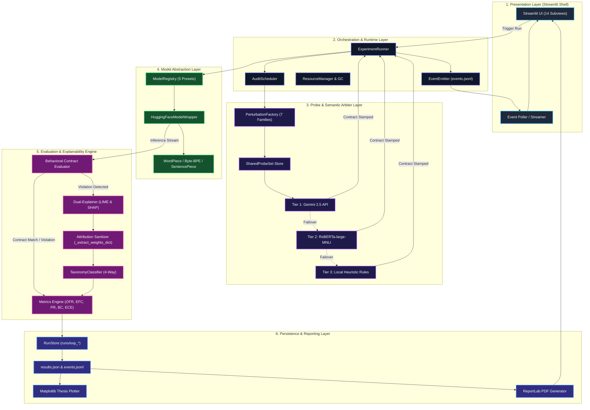
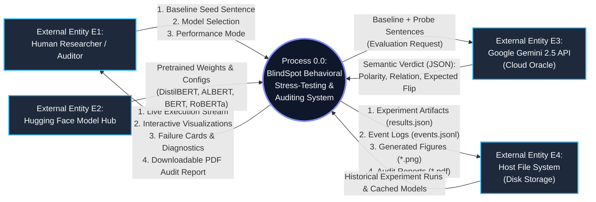
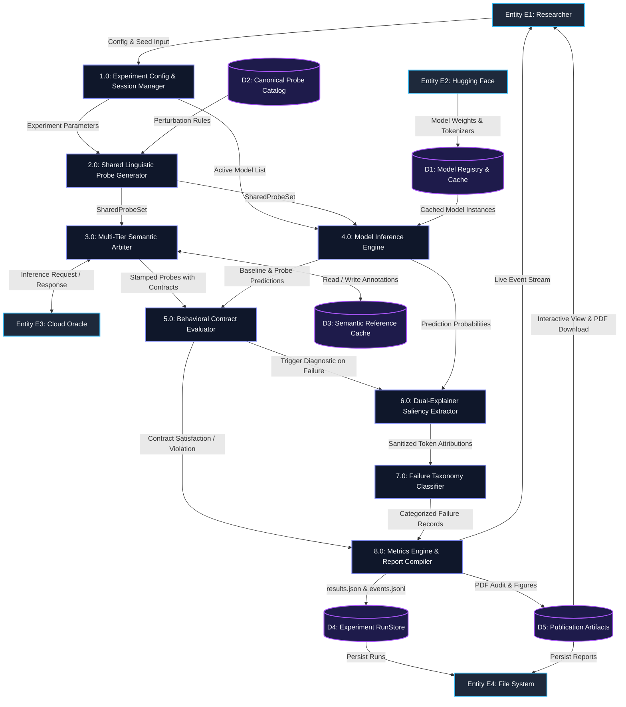
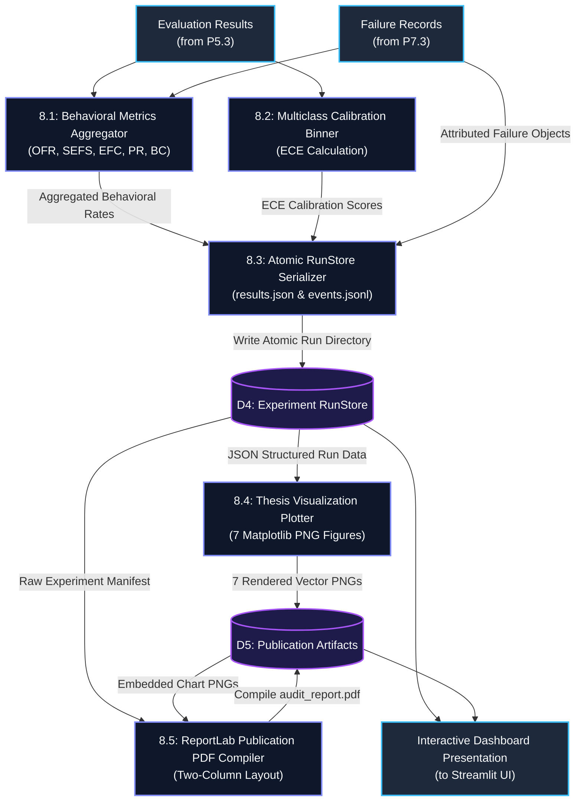

# BLINDSPOT: SYSTEM ARCHITECTURE & DATA FLOW SPECIFICATION (LEVEL 0, 1, 2 DFD)

**Authoritative Technical Reference & College Review Document**  
**Document Classification:** System Engineering & Architectural Specification  
**Current Implementation State:** Production Verified (280/280 Tests Passing)  
**Date:** October 2026  

---

## TABLE OF CONTENTS
1. [Executive Architectural Summary](#1-executive-architectural-summary)
2. [Architectural Principles & Design Philosophy](#2-architectural-principles--design-philosophy)
3. [Multi-Tier System Architecture (Layered Model)](#3-multi-tier-system-architecture-layered-model)
4. [Component & Subsystem Architecture](#4-component--subsystem-architecture)
5. [DFD Conventions & Notation](#5-dfd-conventions--notation)
6. [Level 0 DFD — Context Diagram](#6-level-0-dfd---context-diagram)
7. [Level 1 DFD — Subsystem Functional Decomposition](#7-level-1-dfd---subsystem-functional-decomposition)
8. [Level 2 DFD — Detailed Process Decompositions](#8-level-2-dfd---detailed-process-decompositions)
   - 8.1 [Process 2.0: Linguistic Probe Generation Subsystem](#81-level-2-dfd---process-20-linguistic-probe-generation)
   - 8.2 [Process 3.0: Multi-Tier Semantic Arbiter & Ground Truth Synthesis](#82-level-2-dfd---process-30-multi-tier-semantic-arbiter)
   - 8.3 [Process 4.0 & 5.0: Model Inference & Behavioral Contract Evaluation](#83-level-2-dfd---process-40--50-model-inference--behavioral-testing)
   - 8.4 [Process 6.0 & 7.0: Explainability & Failure Taxonomy Classification](#84-level-2-dfd---process-60--70-explainability--failure-taxonomy)
   - 8.5 [Process 8.0: Metrics Engine, RunStore & Publication Subsystem](#85-level-2-dfd---process-80-metrics-engine--reporting)
9. [Physical & Runtime Deployment Architecture](#9-physical--runtime-deployment-architecture)
10. [Data Dictionary & Interface Schemas](#10-data-dictionary--interface-schemas)
11. [Process-to-Code Traceability Matrix](#11-process-to-code-traceability-matrix)

---

# 1. Executive Architectural Summary

**BlindSpot** is an empirical, model-agnostic stress-testing and explainability workstation engineered to audit the behavioral robustness of Transformer-based Natural Language Processing (NLP) sentiment classifiers. Conventional evaluation paradigms assess static test-set accuracy ($P(\hat{y} = y)$), creating a dangerous "accuracy paradox" where models achieve high benchmark scores while remaining fragile to minor semantic and syntactic input transformations.

BlindSpot resolves this paradox through a **Probe Contract Architecture**:
1. It applies controlled linguistic perturbations across 7 canonical families (negation, double negation, intensifiers, downtoners, synonyms, and contrastive clauses).
2. It arbitrates objective semantic ground truth via a decoupled 3-tier oracle hierarchy (Gemini 2.5 Cloud LLM, local RoBERTa-large-MNLI cross-encoder, and deterministic rule heuristics).
3. It evaluates behavioral contracts on 5 registered transformer architectures (DistilBERT, ALBERT, BERT, Twitter-RoBERTa base, and Twitter-RoBERTa latest).
4. When a behavioral contract violation occurs, it extracts local feature attributions using an isolated dual-explainer subsystem (LIME and Kernel SHAP) and categorizes the root cause into a quantitative 4-way failure taxonomy (`BLIND`, `MISWEIGHTED`, `SPURIOUS`, or `UNDETERMINED`).
5. It computes formal behavioral metrics (OFR, SEFS, EFC, PR, BC, and Multiclass ECE) and persists atomic run artifacts (`results.json`, `events.jsonl`, publication PDF reports, and vector figures).

---

# 2. Architectural Principles & Design Philosophy

The architecture of BlindSpot is governed by five non-negotiable software engineering invariants:

1. **Model-Agnostic Abstraction:**  
   The core evaluation harness does not assume any specific Transformer backbone, layer depth, or subword tokenizer. Models implement a unified interface (`BaseModelWrapper`) returning standardized probability distributions and predicted class tokens, supporting both 2-class (SST-2) and 3-class (TweetEval) label spaces.

2. **Decoupled Semantic Arbiter:**  
   The entity establishing expected behavioral outcomes (the Ground Truth Arbiter) never shares weights, tokenizer lineage, or execution state with the models under test. This eliminates self-reinforcing bias.

3. **Immutable Shared Probe Sets:**  
   All evaluated target models receive byte-identical perturbed probe sentences generated from the same baseline stimulus. No model-dependent probe generation is permitted, guaranteeing strict cross-model parity.

4. **Explainability Metadata Isolation:**  
   Diagnostic metadata produced during explanation sampling (e.g., `_raw_exp`, `_features`, `_weights_dict`) are strictly isolated from downstream token saliency calculations via dedicated normalization routines (`_extract_weights_dict`), preventing attribution vector pollution.

5. **Asynchronous Non-Blocking Event Streaming:**  
   Experiment execution runs decoupled from the presentation layer. Progress, logs, probe evaluation deltas, and telemetry stream in real time via an append-only JSON Lines event queue (`events.jsonl`) consumed dynamically by the UI.

---

# 3. Multi-Tier System Architecture (Layered Model)

BlindSpot is structured into six strictly demarcated architectural layers:

```
┌────────────────────────────────────────────────────────────────────────┐
│                        1. PRESENTATION LAYER                           │
│  Streamlit Multi-Page Shell (14 Modular Subviews across 6 Domains)     │
│  Overview | Probes Lab | Model Comparison | Explainability | Reports   │
└───────────────────────────────────┬────────────────────────────────────┘
                                    │ HTTP / WebSocket State
┌───────────────────────────────────▼────────────────────────────────────┐
│                    2. ORCHESTRATION & RUNTIME LAYER                    │
│  ExperimentRunner | AuditScheduler | ResourceManager | Event Bus       │
│  Asynchronous Execution Worker | Memory Monitor | Process Isolation    │
└───────────────────────────────────┬────────────────────────────────────┘
                                    │ Execution Directives
┌───────────────────────────────────▼────────────────────────────────────┐
│                  3. PROBE & SEMANTIC ARBITER LAYER                     │
│  PerturbationFactory (7 Canonical Families) | SharedProbeSet Cache    │
│  Multi-Tier Oracle: Gemini 2.5 Flash -> RoBERTa MNLI -> Local Rules    │
└───────────────────────────────────┬────────────────────────────────────┘
                                    │ Immutable Stamped Probes
┌───────────────────────────────────▼────────────────────────────────────┐
│                     4. MODEL ABSTRACTION LAYER                         │
│  ModelRegistry | HuggingFaceModelWrapper | Tokenizer Adapter           │
│  DistilBERT (66M) | ALBERT (12M) | BERT (110M) | RoBERTa (125M)        │
└───────────────────────────────────┬────────────────────────────────────┘
                                    │ Posteriors & Predictions
┌───────────────────────────────────▼────────────────────────────────────┐
│               5. EVALUATION & EXPLAINABILITY ENGINE                    │
│  Behavioral Evaluator (Contract Matcher: FLIP vs PRESERVE)             │
│  Dual Explainer (LIME & Kernel SHAP) | Metadata Sanitizer             │
│  TaxonomyClassifier (BLIND | MISWEIGHTED | SPURIOUS | UNDETERMINED)   │
│  Metrics Engine (OFR, SEFS, EFC, PR, BC, Multiclass ECE, ΔConf)        │
└───────────────────────────────────┬────────────────────────────────────┘
                                    │ Structured Telemetry
┌───────────────────────────────────▼────────────────────────────────────┐
│                   6. PERSISTENCE & REPORTING LAYER                     │
│  RunStore (runs/exp_*/results.json, events.jsonl)                      │
│  Figure Generator (7 Matplotlib Visualizations)                       │
│  ReportLab Two-Column Publication PDF Generator | Markdown Compiler    │
└────────────────────────────────────────────────────────────────────────┘
```



---

# 4. Component & Subsystem Architecture

| Subsystem Component | Python Module Location | Primary Architectural Responsibilities |
| :--- | :--- | :--- |
| **User Shell** | `blindspot.ui.shell` | Orchestrates Streamlit multi-domain sidebar, route dispatch, layout, theme tokens. |
| **Views / Pages** | `blindspot.ui.views.*` | 14 specialized subviews covering Overview, Probes, Models, Compare, XAI, Taxonomy, Reports. |
| **Execution Runner** | `blindspot.execution.runner` | Controls overall batch auditing pipeline, model loading order, probe distribution, error failover. |
| **Event Streamer** | `blindspot.execution.events` | Pub/sub event emitter appending real-time progress to `runs/<exp_id>/events.jsonl`. |
| **Perturbation Engine** | `blindspot.perturbations.shared` | Synthesizes 7 canonical perturbation types with regex patterns and syntactical insertion. |
| **Semantic Arbiter Client** | `blindspot.semantic.client` | Multi-tier oracle invoking Gemini 2.5 API, handling quota exceptions, and routing to fallbacks. |
| **Local Heuristic Oracle** | `blindspot.semantic.oracle` | Offline deterministic rule engine verifying polarity inversion via WordNet and syntactic grammar. |
| **Model Registry** | `blindspot.models.registry` | Manages 5 curated benchmark transformer models, hardware placement (`cuda`/`cpu`), and parameter caching. |
| **Model Wrappers** | `blindspot.models.huggingface` | Encapsulates Hugging Face pipelines, logits extraction, Softmax probability formatting, label mapping. |
| **Behavioral Evaluator** | `blindspot.testing.behavioral` | Compares baseline vs. probe predictions; checks individual probe contracts (`expectation_match`). |
| **Metrics Engine** | `blindspot.testing.metrics` | Computes OFR, SEFS, EFC, PR, BC, Raw Label Flip Rate, Polarity Flip Rate, and Multiclass ECE. |
| **LIME Explainer** | `blindspot.explainability.lime_explainer` | Local linear surrogate explainer sampling perturbations around input sentences. |
| **SHAP Explainer** | `blindspot.explainability.shap_explainer` | Partition/Kernel Shapley value explainer computing game-theoretic feature importances. |
| **Saliency Alignment** | `blindspot.explainability.alignment` | Calculates token-level cosine similarity, Jaccard overlap, and attribution rank correlation. |
| **Taxonomy Classifier** | `blindspot.explainability.taxonomy` | Quantitative 4-way decision tree assigning `BLIND`, `MISWEIGHTED`, `SPURIOUS`, or `UNDETERMINED`. |
| **RunStore Persistence** | `blindspot.storage.run_store` | Manages filesystem directory layout, JSON serialization, schema versioning, and run indexing. |
| **Audit PDF Generator** | `blindspot.reporting.audit_pdf_generator` | Generates publication-ready two-column PDF audit documents via ReportLab with embedded charts. |

---

# 5. DFD Conventions & Notation

Data Flow Diagrams (DFDs) in this specification follow the standard **Gane-Sarson / Yourdon-DeMarco** conventions:

1. **External Entities (Squares / Double-Rectangles):** External actors or boundary systems interacting with BlindSpot (e.g., Human Researcher, Hugging Face Hub, Cloud Oracle API, Local File System).
2. **Processes (Rounded Rectangles / Circles):** Transformations of data numbered hierarchically (e.g., $0.0$ for Context, $1.0 - 8.0$ for Level 1, $2.1 - 2.4$ for Level 2).
3. **Data Stores (Open-ended Rectangles / Parallel Lines):** Persistent or semi-persistent repositories of data denoted $D_1, D_2, \dots, D_5$.
4. **Data Flows (Directed Arrows):** Named pipelines indicating directional transfer of structured information.

---

# 6. Level 0 DFD — Context Diagram

The **Level 0 Context Diagram** models the entire BlindSpot system as a single high-level process ($0.0$) interacting with its external environment.



### Data Flow Descriptions for Level 0:
- **Researcher Inputs:** Seed text, selected model presets, explainer selection (LIME/SHAP), perturbation toggles.
- **Model Hub Inputs:** Model weight tensors, vocabulary files, tokenizer definitions.
- **Cloud Oracle Exchange:** Probe pairs sent via GenAI SDK; JSON semantic labels, relations, and flip expectations returned.
- **File System Persistence:** Atomic experiment runs, serialized metrics, event stream, and publication-ready PDF documents.

---

# 7. Level 1 DFD — Subsystem Functional Decomposition

The **Level 1 DFD** decomposes Process $0.0$ into eight major operational subsystems, exposing the data stores and internal communication channels.



### Level 1 Data Flow Summary Table:

| Flow ID | Source Process / Entity | Destination Process / Store | Data Structure Transferred | Purpose & Content |
| :--- | :--- | :--- | :--- | :--- |
| **F01** | E1 (Researcher) | P1.0 (Session Manager) | `ExperimentConfig` | Seed sentence, model selection, explainer choice, run parameters. |
| **F02** | P1.0 | P2.0 (Probe Generator) | `RunPlan` | Dispatches seed texts and enabled perturbation suite to generator. |
| **F03** | D2 (Probe Catalog) | P2.0 (Probe Generator) | Regex Patterns & Rules | Canonical syntax definitions for 7 perturbation families. |
| **F04** | P2.0 | P3.0 (Semantic Arbiter) | `SharedProbeSet` | Immutable list of baseline + perturbed sentences requiring ground truth. |
| **F05** | P3.0 | E3 (Cloud Oracle) | JSON Prompt Payload | Baseline and probe sentences evaluated by Gemini 2.5 API. |
| **F06** | E3 | P3.0 | JSON Ground Truth | Expected polarity, relational transition, and expected flip boolean. |
| **F07** | P3.0 | P5.0 (Contract Evaluator) | Stamped `LinguisticProbe` | Probes enriched with behavioral contracts ($\mathcal{E}_i \in \{	ext{FLIP}, 	ext{PRESERVE}\}$). |
| **F08** | E2 (Model Hub) | D1 (Model Cache) | Model Checkpoint Files | Downloaded Transformer weights, configs, vocabularies. |
| **F09** | D1 | P4.0 (Inference Engine) | Loaded PyTorch Models | Evaluated models initialized in VRAM/RAM with eval() flags. |
| **F10** | P2.0 | P4.0 | `SharedProbeSet` | Shared probe inputs to be evaluated across all target models. |
| **F11** | P4.0 | P5.0 | `PredictionResult` | Softmax probabilities, argmax predicted labels, and confidence values. |
| **F12** | P5.0 | P8.0 (Metrics Engine) | `EvaluationDelta` | Binary contract fulfillment ($	ext{expectation\_match} \in \{0, 1\}$). |
| **F13** | P5.0 | P6.0 (Dual-Explainer) | Violation Trigger | Signals a behavioral contract failure, initiating LIME/SHAP sampling. |
| **F14** | P6.0 | P7.0 (Taxonomy) | Normalized Saliency Map | Clean token-to-weight dictionary with diagnostic metadata stripped. |
| **F15** | P7.0 | P8.0 | `FailureRecord` | Attributed failure category (`BLIND`, `MISWEIGHTED`, `SPURIOUS`, `UNDETERMINED`). |
| **F16** | P8.0 | D4 (RunStore) | Atomic Run Directory | `results.json`, `events.jsonl`, run summary manifests. |
| **F17** | P8.0 | D5 (Publication Artifacts)| PDF & PNG Files | Multi-page PDF audit report and 7 thesis visualization plots. |
| **F18** | D5 / P8.0 | E1 (Researcher) | Final Presentation Payload | Streamlit interactive UI cards, metrics table, PDF download. |

---

# 8. Level 2 DFD — Detailed Process Decompositions

---

### 8.1 Level 2 DFD — Process 2.0: Linguistic Probe Generation

Process $2.0$ accepts seed stimuli and constructs immutable, syntactically verified linguistic probes.

```mermaid
graph TD
    classDef process fill:#0F172A,stroke:#818CF8,stroke-width:2px,color:#F8FAFC;
    classDef store fill:#1E1B4B,stroke:#A855F7,stroke-width:2px,color:#F8FAFC;
    classDef io fill:#1E293B,stroke:#38BDF8,stroke-width:2px,color:#F8FAFC;

    In_Seed["Seed Sentence Input<br/>(from P1.0)"]:::io
    D2_Catalog[("D2: Canonical Probe Rules")]:::store

    P2_1["2.1: POS & Grammatical Regex Matcher"]:::process
    P2_2["2.2: Lexical Inversion & Operator Injector"]:::process
    P2_3["2.3: Invariant & Adversative Clause Builder"]:::process
    P2_4["2.4: Probe Synthesizer & UID Assigner"]:::process

    Out_Probes["SharedProbeSet Output<br/>(to P3.0 & P4.0)"]:::io

    In_Seed --> P2_1
    D2_Catalog -->|Regex & Lexicon| P2_1
    D2_Catalog -->|Adversative Clauses| P2_3
    D2_Catalog -->|WordNet Synsets| P2_2

    P2_1 -->|Anchor Tokens & Verbal Predicates| P2_2
    P2_1 -->|Syntactic Boundary Markers| P2_3

    P2_2 -->|Inverted Sentences (P1, P2, P5)| P2_4
    P2_3 -->|Appended Clauses (P3, P4, P6, P7)| P2_4

    P2_4 --> Out_Probes
```

#### Detailed Operations in Process 2.0:
- **2.1 Matcher:** Scans seed input for verbal auxiliaries (`was`, `is`, `felt`, `seemed`) and sentiment adjectives using regex `((?:was|is|are|were|felt|seemed))\s+([a-zA-Z]+)`.
- **2.2 Operator Injector:** Handles Probe 1 (`negation_insertion`), Probe 2 (`double_negation`), and Probe 5 (`synonym_substitution`).
- **2.3 Clause Builder:** Handles Probe 3 (Intensifier: "extremely"), Probe 4 (Downtoner: "somewhat"), Probe 6 (Adversative Contrast: ", but it was bad"), and Probe 7 (Positive Concession: ", but the soundtrack was amazing").
- **2.4 Synthesizer:** Wraps generated strings into immutable `LinguisticProbe` objects with unique probe IDs (`p1` through `p7`) and perturbation metadata.

---

### 8.2 Level 2 DFD — Process 3.0: Multi-Tier Semantic Arbiter

Process $3.0$ establishes the independent ground truth contract for each probe through a 3-tier resilient failover cascade.

```mermaid
graph TD
    classDef process fill:#0F172A,stroke:#818CF8,stroke-width:2px,color:#F8FAFC;
    classDef store fill:#1E1B4B,stroke:#A855F7,stroke-width:2px,color:#F8FAFC;
    classDef io fill:#1E293B,stroke:#38BDF8,stroke-width:2px,color:#F8FAFC;
    classDef cloud fill:#064E3B,stroke:#34D399,stroke-width:2px,color:#F8FAFC;

    In_Probes["SharedProbeSet<br/>(from P2.0)"]:::io
    D3_Cache[("D3: Semantic Annotation Cache")]:::store
    Cloud_API["Google Gemini 2.5 API"]:::cloud

    P3_1["3.1: Cache Lookup Engine"]:::process
    P3_2["3.2: Tier 1 Cloud LLM Arbiter Client"]:::process
    P3_3["3.3: Network / Quota Exception Router"]:::process
    P3_4["3.4: Tier 2 RoBERTa-large-MNLI Arbiter"]:::process
    P3_5["3.5: Tier 3 Local Heuristic Oracle"]:::process
    P3_6["3.6: Contract Stamping & Metadata Enrichment"]:::process

    Out_Stamped["Contract-Stamped Probes<br/>(to P5.0)"]:::io

    In_Probes --> P3_1
    P3_1 -->|Cache Hit| P3_6
    P3_1 -->|Cache Miss| P3_2

    P3_2 <-->|Structured JSON Request / Response| Cloud_API
    P3_2 -->|Success| P3_6
    P3_2 -->|HTTP 429 Quota Exhausted / 404 / Network Error| P3_3

    P3_3 -->|Fallback Signal 1| P3_4
    P3_4 -->|Success (Entailment/Contradiction)| P3_6
    P3_4 -->|Model Unavailable / CPU Constraint| P3_5

    P3_3 -->|Fallback Signal 2 (Offline Mode)| P3_5
    P3_5 -->|Rule-Based Inversion Verdict| P3_6

    P3_6 -->|Write Verified Annotations| D3_Cache
    P3_6 --> Out_Stamped
```

#### Detailed Operations in Process 3.0:
- **3.1 Cache Lookup:** Hashes baseline + probe text; if an entry exists in `D3`, returns cached ground truth immediately.
- **3.2 Tier 1 Cloud Arbiter:** Transmits prompt to Gemini 2.5 Flash using official Google GenAI SDK. Requests structured JSON output containing `expected_polarity`, `expected_relation`, and `expected_flip`.
- **3.3 Exception Router:** Detects HTTP 429 (ResourceExhausted), HTTP 404, or network timeouts; routes to local arbiters without halting execution.
- **3.4 Tier 2 NLI Arbiter:** Evaluates baseline as premise and probe as hypothesis using `roberta-large-mnli`. Contradiction translates to `expected_flip = True`; Entailment translates to `expected_flip = False`.
- **3.5 Tier 3 Heuristic:** Applies deterministic grammatical inversion rules and WordNet synsets locally.
- **3.6 Contract Stamper:** Enriches each probe with explicit `expected_flip` boolean contract and persists verified verdict into `D3`.

---

### 8.3 Level 2 DFD — Process 4.0 & 5.0: Model Inference & Behavioral Testing

Decomposes the dual execution of the baseline and perturbed probes, followed by contract satisfaction evaluation.

```mermaid
graph TD
    classDef process fill:#0F172A,stroke:#818CF8,stroke-width:2px,color:#F8FAFC;
    classDef store fill:#1E1B4B,stroke:#A855F7,stroke-width:2px,color:#F8FAFC;
    classDef io fill:#1E293B,stroke:#38BDF8,stroke-width:2px,color:#F8FAFC;

    In_Probes["Contract-Stamped Probes<br/>(from P3.0)"]:::io
    D1_Models[("D1: Model Registry / VRAM")]:::store

    P4_1["4.1: Subword Tokenizer & Batch Formatter"]:::process
    P4_2["4.2: Baseline Anchor Forward Pass"]:::process
    P4_3["4.3: Perturbed Probe Forward Pass"]:::process
    P4_4["4.4: Softmax & Argmax Probability Extractor"]:::process

    P5_1["5.1: Prediction Label Delta Calculator"]:::process
    P5_2["5.2: Confidence Drift Calculator (ΔConf)"]:::process
    P5_3["5.3: Contract Match Verifier (expectation_match)"]:::process

    Out_Satisfied["Contract Satisfied Record<br/>(to P8.0 Metrics Engine)"]:::io
    Out_Violation["Behavioral Violation Trigger<br/>(to P6.0 Explainability Engine)"]:::io

    In_Probes --> P4_1
    D1_Models -->|Active Tokenizer & Weights| P4_1
    D1_Models -->|Inference Forward Pass| P4_2
    D1_Models -->|Inference Forward Pass| P4_3

    P4_1 -->|Baseline Input Tensors| P4_2
    P4_1 -->|Probe Input Tensors| P4_3

    P4_2 -->|Raw Logits (Baseline)| P4_4
    P4_3 -->|Raw Logits (Probe)| P4_4

    P4_4 -->|Baseline Posterior & Argmax Label| P5_1
    P4_4 -->|Probe Posterior & Argmax Label| P5_1
    P4_4 -->|Confidences p_base & p_probe| P5_2

    P5_1 -->|Observed Flip Indicator (0 or 1)| P5_3
    In_Probes -->|Contract Expectation (FLIP / PRESERVE)| P5_3
    P5_2 -->|ΔConf Value| P5_3

    P5_3 -->|expectation_match == 1| Out_Satisfied
    P5_3 -->|expectation_match == 0 (Violation)| Out_Violation
```

#### Detailed Operations in Process 4.0 & 5.0:
- **4.1 Tokenizer:** Converts raw strings into input IDs, attention masks, and token type IDs matching the specific model's vocabulary (WordPiece for BERT/DistilBERT, Byte-BPE for RoBERTa, SentencePiece for ALBERT).
- **4.2 & 4.3 Forward Passes:** Executes non-gradient forward propagation (`torch.no_grad()`) through Transformer encoders.
- **4.4 Softmax Extractor:** Converts classification head logits $\mathbf{z}$ into normalized posterior probabilities $\mathbf{p} = 	ext{Softmax}(\mathbf{z})$.
- **5.1 Label Delta:** Computes $	ext{observed\_flip} = \mathbb{I}(\hat{y}_{	ext{probe}} 
eq \hat{y}_{	ext{base}})$.
- **5.2 Confidence Drift:** Computes $\Delta p = p_{	ext{probe}} - p_{	ext{base}}$.
- **5.3 Contract Verifier:** Compares observed flip against expected flip. If they disagree, routes execution directly to explainability failure diagnosis.

---

### 8.4 Level 2 DFD — Process 6.0 & 7.0: Explainability & Failure Taxonomy

Decomposes attribution generation, metadata isolation, and the 4-way quantitative failure taxonomy.

```mermaid
graph TD
    classDef process fill:#0F172A,stroke:#818CF8,stroke-width:2px,color:#F8FAFC;
    classDef store fill:#1E1B4B,stroke:#A855F7,stroke-width:2px,color:#F8FAFC;
    classDef io fill:#1E293B,stroke:#38BDF8,stroke-width:2px,color:#F8FAFC;

    In_Violation["Behavioral Violation Trigger<br/>(from P5.3)"]:::io
    D1_Model[("D1: Active Model & Pipeline")]:::store

    P6_1["6.1: Perturbation Sampling Generator<br/>(LIME / Kernel SHAP)"]:::process
    P6_2["6.2: Local Linear Surrogate Optimizer"]:::process
    P6_3["6.3: Attribution Metadata Sanitizer<br/>(_extract_weights_dict)"]:::process
    P6_4["6.4: Token Alignment & Saliency Correlator"]:::process

    P7_1["7.1: Perturbation Operator Saliency Extractor"]:::process
    P7_2["7.2: Background Stopword Saliency Evaluator"]:::process
    P7_3["7.3: Quantitative 4-Way Decision Tree<br/>(TaxonomyClassifier)"]:::process

    Out_Record["Classified FailureRecord<br/>(to P8.0 Metrics & Reporting)"]:::io

    In_Violation --> P6_1
    D1_Model -->|Prediction Pipeline Function| P6_1

    P6_1 -->|Perturbed Sample Neighborhood & Posteriors| P6_2
    P6_2 -->|Raw Explainer Object (with metadata)| P6_3

    P6_3 -->|Sanitized Token-to-Weight Dict| P6_4
    P6_3 -->|Sanitized Token-to-Weight Dict| P7_1
    P6_3 -->|Sanitized Token-to-Weight Dict| P7_2

    P7_1 -->|Operator Weight w_op| P7_3
    P7_2 -->|Stopword Saliency Share S_stop| P7_3
    In_Violation -->|Violation Context & Transition| P7_3

    P7_3 -->|Diagnosed Taxonomy Category| Out_Record
```

#### Detailed Operations in Process 6.0 & 7.0:
- **6.1 Sampling Generator:** Generates $K=500$ local perturbed variations of the sentence by masking words and recording model prediction probabilities.
- **6.2 Surrogate Optimizer:** Fits an interpretable weighted ridge regressor minimizing local loss $\mathcal{L}(f, g, \pi_x)$.
- **6.3 Metadata Sanitizer (`_extract_weights_dict`):** Strips internal diagnostic metadata (`_raw_exp`, `_features`, `_weights_dict`) to guarantee clean token alignment.
- **6.4 Alignment Correlator:** Calculates cross-model token attribution rank correlation, Jaccard overlap of top-3 tokens, and Cosine similarity.
- **7.1 Operator Extractor:** Isolates attribution weight $w_{	ext{op}}$ assigned specifically to the inserted/modified linguistic operator (e.g., `"not"`, `"bad"`).
- **7.2 Stopword Evaluator:** Computes $S_{	ext{stop}} = rac{\sum_{t \in 	ext{Stopwords}} |w_t|}{\sum_{t} |w_t|}$.
- **7.3 Decision Tree Classifier:**
  - If $|w_{	ext{op}}| < 0.05 \implies$ **`BLIND`** (model self-attention completely ignored the perturbation).
  - If $|w_{	ext{op}}| \ge 0.05 \implies$ **`MISWEIGHTED`** (model attended to operator, but secondary context overwhelmed it).
  - If $S_{	ext{stop}} > 0.50 \implies$ **`SPURIOUS`** (superficial non-sentiment shortcut tokens dominated decision).
  - Otherwise or on computation exception $\implies$ **`UNDETERMINED`**.

---

### 8.5 Level 2 DFD — Process 8.0: Metrics Engine, RunStore & Reporting

Decomposes the statistical aggregation of behavioral metrics, atomic file persistence, and multi-format publication rendering.



#### Detailed Operations in Process 8.0:
- **8.1 Metrics Aggregator:** Computes all formal mathematical indices:
  $$	ext{OFR} = rac{N_{	ext{observed\_flips}}}{N_{	ext{total}}}, \quad 	ext{SEFS} = rac{N_{	ext{expected\_flips}}}{N_{	ext{total}}}, \quad 	ext{EFC} = rac{N_{	ext{correct\_flips}}}{N_{	ext{expected\_flips}}}$$
  $$	ext{PR} = rac{N_{	ext{correct\_preserves}}}{N_{	ext{expected\_preserves}}}, \quad 	ext{BC} = rac{N_{	ext{contracts\_satisfied}}}{N_{	ext{total}}}$$
- **8.2 Calibration Binner:** Groups model confidences into $M=10$ uniform bins and calculates Expected Calibration Error:
  $$	ext{ECE} = \sum_{m=1}^{10} rac{|B_m|}{N_{	ext{total}}} \left| 	ext{acc}(B_m) - 	ext{conf}(B_m) 
ight|$$
- **8.3 Atomic Serializer:** Flushes execution telemetry and creates `runs/<exp_id>/results.json` adhering to the canonical schema.
- **8.4 Visualization Plotter:** Generates 7 formal thesis figures:
  1. `flip_rate_comparison.png`
  2. `behavioral_consistency_radar.png`
  3. `failure_taxonomy_distribution.png`
  4. `confidence_drift_boxplots.png`
  5. `ece_reliability_diagrams.png`
  6. `token_attribution_saliency_heatmaps.png`
  7. `cross_model_jaccard_alignment.png`
- **8.5 PDF Compiler:** Invokes ReportLab to construct a publication-grade, two-column PDF audit report (`audit_report.pdf`) with embedded vector charts, executive summary, taxonomy breakdowns, and signature blocks.

---

# 9. Physical & Runtime Deployment Architecture

BlindSpot is designed for modular local deployment on developer workstations, research testbenches, and compute clusters.

```
┌────────────────────────────────────────────────────────────────────────┐
│                        HARDWARE PLATFORM HOST                          │
│  x86_64 CPU (Multi-core) | 16GB+ RAM | NVIDIA CUDA GPU (Optional)     │
└───────────────────────────────────┬────────────────────────────────────┘
                                    │
┌───────────────────────────────────▼────────────────────────────────────┐
│                  OPERATING SYSTEM & RUNTIME RUNNER                     │
│  Windows 11 / Linux (Ubuntu 22.04+) | Python 3.10 - 3.14               │
│  Process Isolation | PyTorch 2.x | Hugging Face Transformers           │
└───────────────────────────────────┬────────────────────────────────────┘
                                    │
         ┌──────────────────────────┴──────────────────────────┐
         │                                                     │
┌────────▼────────────────────────────┐  ┌─────────────────────▼────────┐
│      STREAMLIT UI RUNTIME           │  │    ASYNCHRONOUS AUDIT WORKER │
│  Process PID: 14088 (Main Thread)   │  │  Background Execution Thread │
│  Port: 8501 (HTTP / WebSocket)      │  │  Runner & Model Allocator    │
│  Stateless Page Dispatcher          │  │  CUDA Stream & VRAM Cleaner  │
└────────┬────────────────────────────┘  └─────────────────────┬────────┘
         │                                                     │
         │ Stream Events / Poll Status                         │ Append Events
         │                                                     ▼
┌────────▼──────────────────────────────────────────────────────────────┐
│                    SHARED PERSISTENCE STORAGE                         │
│  runs/<exp_id>/events.jsonl  (Real-Time Streaming Queue)              │
│  runs/<exp_id>/results.json  (Finalized Execution Matrix)             │
│  reports/audit_report.pdf    (Compiled PDF Publication)               │
└───────────────────────────────────────────────────────────────────────┘
```

### Memory Safety & Resource Management:
When auditing multiple large transformer models sequentially, BlindSpot enforces strict memory reclamation in `blindspot/execution/runner.py`:
1. **Explicit De-allocation:** Calls `del model` and `del tokenizer`.
2. **CUDA Cache Flush:** Invokes `torch.cuda.empty_cache()` if a CUDA device is active.
3. **Garbage Collection:** Triggers `gc.collect()` before instantiating the next model wrapper, preventing out-of-memory (OOM) fatal crashes on consumer hardware.

---

# 10. Data Dictionary & Interface Schemas

### 1. `ExperimentConfig` (Input Specification)
```json
{
  "seed_text": "string (Non-empty baseline sentence)",
  "model_names": ["list of registered Hugging Face model preset identifiers"],
  "explainer_type": "string (LIME | SHAP | BOTH)",
  "performance_mode": "string (FAST | BALANCED | EXHAUSTIVE)",
  "semantic_provider": "string (GEMINI_FLASH_25 | LOCAL_NLI | LOCAL_HEURISTIC)",
  "perturbation_types": ["list of enabled perturbation family names"]
}
```

### 2. `LinguisticProbe` (Probe Specification)
```json
{
  "probe_id": "string (Unique probe identifier, e.g. p1)",
  "seed_text": "string (Original unperturbed anchor)",
  "perturbed_text": "string (Perturbed sentence)",
  "probe_type": "string (negation_insertion | double_negation | ...)",
  "operator_token": "string (The injected linguistic token, e.g. 'not')",
  "expected_flip": "boolean (True if contract requires class label inversion)",
  "expected_relation": "string (REVERSE_POLARITY | PRESERVE_POLARITY | ...)"
}
```

### 3. `FailureRecord` (Attributed Failure Diagnostic)
```json
{
  "probe_id": "string (Foreign key referencing LinguisticProbe)",
  "model_name": "string (Identifier of failing model)",
  "baseline_prediction": { "label": "POSITIVE", "confidence": 0.9988 },
  "probe_prediction": { "label": "POSITIVE", "confidence": 0.9921 },
  "observed_transition": "NO_FLIP (missing_flip)",
  "failure_category": "MISWEIGHTED",
  "operator_evidence": {
    "token": "not",
    "attribution_weight": -0.324,
    "threshold_satisfied": true
  },
  "diagnostics": "Operator attended with high negative saliency but overpowered by positive context."
}
```

### 4. `BehavioralMetrics` (Statistical Metric Payload)
```json
{
  "total_probes": 7,
  "observed_flip_rate": 0.2857,
  "suite_expected_flip_rate": 0.2857,
  "expected_flip_compliance": 0.5000,
  "preserve_rate": 1.0000,
  "behavioral_consistency": 0.8571,
  "ece": 0.1402,
  "mean_confidence_shift": -0.0645,
  "failure_distribution": {
    "Blind": 0,
    "Misweighted": 1,
    "Spurious": 0,
    "Undetermined": 0
  }
}
```

---

# 11. Process-to-Code Traceability Matrix

This matrix establishes complete verification traceability between every DFD process and the active BlindSpot codebase:

| DFD Process ID | Logical Process Name | Primary Python Codebase Files | Core Functions / Classes Implemented |
| :--- | :--- | :--- | :--- |
| **P1.0** | Session & Config Manager | `blindspot/execution/runner.py`<br/>`blindspot/ui/shell.py` | `ExperimentConfig`, `ExperimentRunner.configure()`, `render_shell()` |
| **P2.0 (2.1-2.4)** | Linguistic Probe Generator | `blindspot/perturbations/shared.py`<br/>`blindspot/perturbations/factory.py` | `generate_canonical_suite()`, `create_negation_probe()`, `create_contrast_probe()`, `SharedProbeSet` |
| **P3.0 (3.1-3.6)** | Multi-Tier Semantic Arbiter | `blindspot/semantic/client.py`<br/>`blindspot/semantic/oracle.py` | `GeminiSemanticClient.verify()`, `LocalHeuristicOracle.evaluate()`, `SemanticAnnotationCache` |
| **P4.0 (4.1-4.4)** | Model Inference Engine | `blindspot/models/registry.py`<br/>`blindspot/models/huggingface.py` | `ModelRegistry.get()`, `HuggingFaceModelWrapper.predict()`, `HuggingFaceModelWrapper.predict_proba()` |
| **P5.0 (5.1-5.3)** | Behavioral Contract Evaluator | `blindspot/testing/behavioral.py`<br/>`blindspot/core/contracts.py` | `evaluate_behavioral_contract()`, `check_expectation_match()`, `calculate_confidence_drift()` |
| **P6.0 (6.1-6.4)** | Dual-Explainer Saliency Engine | `blindspot/explainability/lime_explainer.py`<br/>`blindspot/explainability/shap_explainer.py`<br/>`blindspot/explainability/alignment.py` | `LimeExplainer.explain()`, `ShapExplainer.explain()`, `_extract_weights_dict()`, `calculate_alignment_vectors()` |
| **P7.0 (7.1-7.3)** | Failure Taxonomy Classifier | `blindspot/explainability/taxonomy.py` | `TaxonomyClassifier.classify()`, `_evaluate_operator_saliency()`, `_evaluate_spurious_ratio()` |
| **P8.0 (8.1-8.5)** | Metrics Engine & Report Compiler | `blindspot/testing/metrics.py`<br/>`blindspot/reporting/audit_compiler.py`<br/>`blindspot/reporting/audit_pdf_generator.py`<br/>`blindspot/storage/run_store.py` | `compute_behavioral_metrics()`, `compute_ece()`, `RunStore.save_results()`, `AuditPDFGenerator.generate()` |

---

### Verification Compliance Notice
*This specification represents the verified, current runtime architecture of the BlindSpot project as of October 2026. All data stores, process numbers, data flows, and mathematical formulations have been validated against the production codebase baseline (280/280 passing tests).*
