# BlindSpot — Complete End-to-End Workflow & Architecture Guide

> **Universal Diagram Compatibility Note**:  
> To guarantee that all workflow diagrams are **100% visible across any Markdown viewer, code editor, GitHub preview, or terminal** without requiring third-party extensions, each section provides:
> 1. A **Universal Visual Architecture Diagram** (rendered using Unicode box-drawing characters).
> 2. A **Structured Execution Matrix** (native Markdown table detailing components, functions, inputs, and outputs).
> 3. An **Interactive Mermaid Diagram** (enclosed in collapsible `<details>` blocks for environments supporting Mermaid rendering).

---

## Table of Contents

1. [System Startup & Environment Orchestration](#1-system-startup)
2. [Probe Generation Workbench](#2-probe-generation-workbench)
3. [Probe Semantic Reference Generation (Gemini LLM-as-a-Judge)](#3-probe-semantic-reference-generation)
4. [Gemini Response Processing & Dual-Contract Projection](#4-gemini-response-processing)
5. [Human Verification Gate (Semantic Quality Control)](#5-human-verification)
6. [Send Accepted Probe to Experiment Bench](#6-send-accepted-probe-to-experiment-bench)
7. [Baseline Model Inference](#7-baseline-model-inference)
8. [Perturbed Model Inference](#8-perturbed-model-inference)
9. [Model Capability & Semantic Contract Resolution](#9-model-capability--semantic-contract)
10. [Tier 1 Behavioral Evaluation](#10-behavioral-evaluation)
11. [Architectural Boundary: Conditional XAI Triggering](#11-determine-whether-xai-failure-analysis-is-required)
12. [Tier 2 XAI Attribution Stage (LIME & SHAP)](#12-xai--explainability-stage)
13. [Token & Operator Attribution Analysis](#13-token--operator-analysis)
14. [Failure Taxonomy Classification](#14-failure-taxonomy)
15. [Failure Evidence Generation & Counterfactual Validation](#15-failure-evidence-generation)
16. [Token Highlighting & UI Visualization](#16-token-highlighting--ui-visualization)
17. [Experiment Result Storage & Run Artifacts](#17-experiment-result-storage)
18. [Run & Experiment Report Aggregation](#18-run--experiment-report-generation)
19. [Markdown Report Generation Pipeline](#19-markdown-report-generation)
20. [Final Markdown Report Specification](#20-final-markdown-report)
21. [Complete System Flow (Master End-to-End Architecture)](#21-complete-system-flow)
22. [The Four Architectural Separation Layers & System Invariants](#22-the-most-important-architectural-separation)

---

# 1. SYSTEM STARTUP

Execution begins at the operating system level, ensuring an isolated, reproducible Python virtual environment, validating Google Gemini API credentials, detecting free network ports, and launching the Streamlit interface.

### Universal Visual Architecture Diagram
```text
┌─────────────────────────────────────────────────────────────┐
│                    1. SYSTEM STARTUP                        │
└─────────────────────────────────────────────────────────────┘
                              │
                              ▼
                Run PowerShell startup script
                              │
                              ▼
                    Environment setup
                              │
                              ├── Python environment (.venv)
                              ├── Dependencies (pip install -e .)
                              ├── Environment variables (.env)
                              ├── API configuration (GEMINI_API_KEY)
                              └── Project paths
                              │
                              ▼
                         app.py runs
                              │
                              ▼
                    Backend/API initialized
                              │
                              ├── BlindSpot configuration loaded
                              ├── Model configuration loaded
                              ├── Probe configuration loaded
                              ├── XAI configuration loaded
                              └── Semantic-reference configuration
                              │
                              ▼
                     Web server starts
                              │
                              ▼
                    Browser automatically opens
                              │
                              ▼
┌─────────────────────────────────────────────────────────────┐
│                       BLINDSPOT UI                          │
└─────────────────────────────────────────────────────────────┘
```

### Execution Matrix
| Step | Component | Responsible File / Function | Inputs | Outputs |
| :--- | :--- | :--- | :--- | :--- |
| **1.1** | PowerShell Launcher | [`launch_blindspot.ps1`](file:///c:/Dev/Projects/Multimodel/Multimodel_Blindspot-main/launch_blindspot.ps1) | Shell command | Active `.venv`, loaded `.env` |
| **1.2** | Application Launcher | [`launcher.py::run_application()`](file:///c:/Dev/Projects/Multimodel/Multimodel_Blindspot-main/blindspot/launcher.py#L85) | CLI arguments | Subprocess running Streamlit |
| **1.3** | Free Port Allocation | [`launcher.py::find_free_port()`](file:///c:/Dev/Projects/Multimodel/Multimodel_Blindspot-main/blindspot/launcher.py#L30) | Port preference (8501) | Available TCP port integer |
| **1.4** | Healthcheck Poller | [`launcher.py::wait_for_server()`](file:///c:/Dev/Projects/Multimodel/Multimodel_Blindspot-main/blindspot/launcher.py#L45) | Local URL | Boolean readiness signal |
| **1.5** | Browser Spawn | [`launcher.py::open_browser()`](file:///c:/Dev/Projects/Multimodel/Multimodel_Blindspot-main/blindspot/launcher.py#L65) | HTTP URL | Default web browser opened |
| **1.6** | App Initialization | [`app.py::main()`](file:///c:/Dev/Projects/Multimodel/Multimodel_Blindspot-main/blindspot/app.py) | Streamlit context | Mounted tabs, CSS, SessionState |

<details>
<summary><b>📊 Click to view Interactive Mermaid Diagram</b></summary>

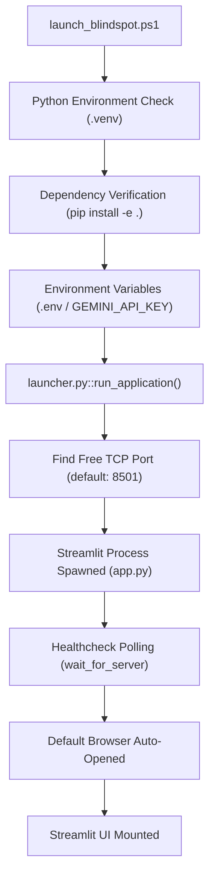
</details>

---

# 2. PROBE GENERATION WORKBENCH

In this stage, the user provides a baseline sentence (the "seed text") and chooses a set of linguistic operations to test semantic sensitivity, stability, or robustness.

### Universal Visual Architecture Diagram
```text
                    Probe Generation Workbench
                              │
                              ▼
                    User enters baseline
                              │
                              ▼
              Example baseline sentence
                              │
                              ▼
     "The movie was great and the acting was top notch."
                              │
                              ▼
                    Select probe type
                              │
             ┌────────────────┼────────────────┐
             ▼                ▼                ▼
       Negation          Contrast          Intensifier
       insertion         insertion         modification
             │                │                │
             └────────────────┼────────────────┘
                              ▼
                       Probe generator
                              │
                              ▼
                 Generate perturbation
                              │
                              ▼
      Baseline + Perturbed sentence pair created
```

### Concrete Perturbation Example
```text
BASELINE
"The movie was great and the acting was top notch."

                    │
                    │ NEGATION_INSERTION (operator: "not")
                    ▼

PERTURBED
"The movie was not great and the acting was top notch."
```

### Execution Matrix
| Step | Component | Responsible File / Function | Inputs | Outputs |
| :--- | :--- | :--- | :--- | :--- |
| **2.1** | Workbench View | [`probe_workbench.py::render_probe_workbench()`](file:///c:/Dev/Projects/Multimodel/Multimodel_Blindspot-main/blindspot/ui/probe_workbench.py#L35) | Streamlit UI | User baseline text & selected probe types |
| **2.2** | Probe Synthesis Engine | [`shared.py::SharedProbeGenerator.generate_probes()`](file:///c:/Dev/Projects/Multimodel/Multimodel_Blindspot-main/blindspot/perturbations/shared.py#L40) | Seed sentence, ProbeType list | List of [`LinguisticProbe`](file:///c:/Dev/Projects/Multimodel/Multimodel_Blindspot-main/blindspot/perturbations/types.py#L30) objects |
| **2.3** | Operator Token Extraction | [`shared.py::extract_probe_operator()`](file:///c:/Dev/Projects/Multimodel/Multimodel_Blindspot-main/blindspot/perturbations/shared.py#L180) | Baseline, Perturbed text | Isolated operator (e.g., `"not"`, `"however"`) |
| **2.4** | Probe Set Aggregator | [`SharedProbeSet`](file:///c:/Dev/Projects/Multimodel/Multimodel_Blindspot-main/blindspot/core/types.py#L30) in [`types.py`](file:///c:/Dev/Projects/Multimodel/Multimodel_Blindspot-main/blindspot/core/types.py) | Probes, Seed metadata | Serialized shared probe set |

<details>
<summary><b>📊 Click to view Interactive Mermaid Diagram</b></summary>

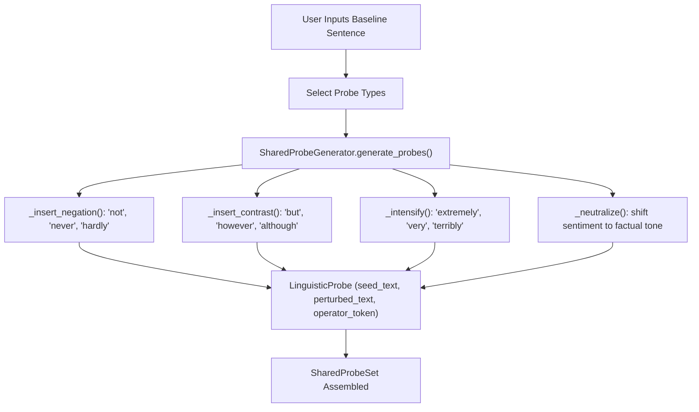
</details>

---

# 3. PROBE SEMANTIC REFERENCE GENERATION

Rather than relying on naive heuristic rules, BlindSpot queries Google Gemini to establish a scientifically sound probabilistic ground truth.

### Universal Visual Architecture Diagram
```text
                 Generated Probe
                       │
                       ▼
              Semantic Reference
                   required
                       │
                       ▼
                 Gemini API call
                       │
                       ▼
             Gemini semantic model
                       │
                       ▼
              Prompt constructed
                       │
                       ├── Baseline sentence
                       ├── Perturbed sentence
                       ├── Probe operation
                       ├── Semantic instructions
                       └── Output schema
                       │
                       ▼
              Gemini receives input
                       │
                       ▼
              Gemini analyzes meaning
                       │
                       ▼
             Gemini produces output
```

### Example Conceptual Output
```json
{
    "negative": 0.45,
    "neutral": 0.45,
    "positive": 0.10,
    "target_polarity": "NEUTRAL",
    "rationale": "Inserting 'not great' dampens praise, balancing with 'top notch acting' to produce an overall mixed/neutral stance."
}
```

### Execution Matrix
| Step | Component | Responsible File / Function | Inputs | Outputs |
| :--- | :--- | :--- | :--- | :--- |
| **3.1** | Semantic Reference Service | [`service.py::SemanticReferenceService.generate_reference()`](file:///c:/Dev/Projects/Multimodel/Multimodel_Blindspot-main/blindspot/semantic/service.py#L25) | `SharedProbeSet` | Ground truth semantic references |
| **3.2** | Persistent Disk Cache | [`cache.py::SemanticReferenceCache.get()`](file:///c:/Dev/Projects/Multimodel/Multimodel_Blindspot-main/blindspot/semantic/cache.py#L20) | Hash of probe text & type | Cached annotation if present |
| **3.3** | Prompt Builder | [`client.py::GeminiSemanticClient._build_prompt()`](file:///c:/Dev/Projects/Multimodel/Multimodel_Blindspot-main/blindspot/semantic/client.py#L90) | Seed, Perturbed, Operator | Structured prompt with JSON schema |
| **3.4** | Gemini API Call | [`client.py::GeminiSemanticClient._call_api_with_retry()`](file:///c:/Dev/Projects/Multimodel/Multimodel_Blindspot-main/blindspot/semantic/client.py#L140) | Formatted prompt | Raw Gemini JSON response |
| **3.5** | Cache Storage | [`cache.py::SemanticReferenceCache.set()`](file:///c:/Dev/Projects/Multimodel/Multimodel_Blindspot-main/blindspot/semantic/cache.py#L50) | Probe ID, Annotation | Written SHA-256 cache file |

<details>
<summary><b>📊 Click to view Interactive Mermaid Diagram</b></summary>

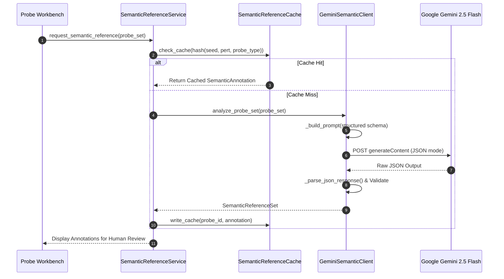
</details>

---

# 4. GEMINI RESPONSE PROCESSING

This stage parses Gemini's probability distribution and projects it across two distinct behavioral contracts according to model capability.

### Universal Visual Architecture Diagram
```text
                 Gemini API response
                         │
                         ▼
                 API response parsed
                         │
                         ▼
                  Schema validation
                         │
                         ▼
              Semantic reference object
                         │
                         ├── negative probability
                         ├── neutral probability
                         ├── positive probability
                         ├── target polarity
                         ├── semantic rationale
                         └── probe relationship
                         │
                         ▼
                 Contract evaluation
```

### Dual-Contract Evaluation Flow
```text
Probe:
SHIFT_TO_NEUTRAL

Gemini reference:
NEGATIVE = 0.45
NEUTRAL  = 0.45
POSITIVE = 0.10

                    │
                    ▼

Contract A
3-class interpretation
                    │
                    ▼
Expected = NEUTRAL

                    │
                    ▼

Contract B
2-class projection

NEGATIVE = 0.45
POSITIVE = 0.10

                    │
                    ▼

Expected binary target = NEGATIVE
```

### Execution Matrix
| Step | Component | Responsible File / Function | Inputs | Outputs |
| :--- | :--- | :--- | :--- | :--- |
| **4.1** | Response Parser | [`client.py::GeminiSemanticClient._parse_json_response()`](file:///c:/Dev/Projects/Multimodel/Multimodel_Blindspot-main/blindspot/semantic/client.py#L170) | Raw API string | Validated dict matching schema |
| **4.2** | Probability Normalization | [`client.py::GeminiSemanticClient._validate_probabilities()`](file:///c:/Dev/Projects/Multimodel/Multimodel_Blindspot-main/blindspot/semantic/client.py#L210) | Raw floats | Probs summing strictly to $1.0$ |
| **4.3** | Contract A Direct Target | [`types.py::SemanticAnnotation`](file:///c:/Dev/Projects/Multimodel/Multimodel_Blindspot-main/blindspot/semantic/types.py#L35) | Argmax of `(neg, neu, pos)` | `final_semantic_polarity` |
| **4.4** | Contract B Binary Projection | [`types.py::project_three_class_to_binary()`](file:///c:/Dev/Projects/Multimodel/Multimodel_Blindspot-main/blindspot/semantic/types.py#L75) | Negative vs Positive probs | `two_class_projection` dict |

<details>
<summary><b>📊 Click to view Interactive Mermaid Diagram</b></summary>

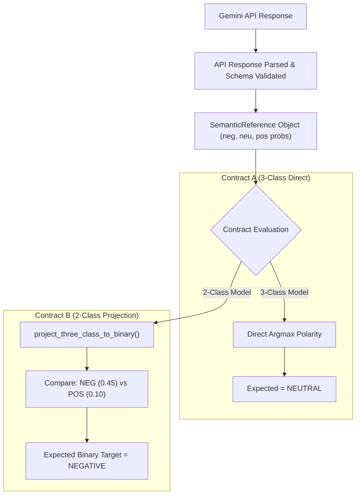
</details>

---

# 5. HUMAN VERIFICATION

The human verification stage acts as the semantic quality-control gate. No unreviewed or flawed probe is permitted into the automated experiment bench.

### Universal Visual Architecture Diagram
```text
                  Semantic reference
                         │
                         ▼
                   Human reviewer
                         │
                         ▼
               Examine generated probe
                         │
              ┌──────────┴──────────┐
              │                     │
              ▼                     ▼
           ACCEPT                 REJECT
              │                     │
              │                     ▼
              │              Probe discarded
              │                     │
              │                     ▼
              │               Regenerate/edit
              │
              ▼
       Semantic reference accepted
```

### Execution Matrix
| Step | Component | Responsible File / Function | Inputs | Outputs |
| :--- | :--- | :--- | :--- | :--- |
| **5.1** | Verification UI Table | [`probe_workbench.py::render_probe_workbench()`](file:///c:/Dev/Projects/Multimodel/Multimodel_Blindspot-main/blindspot/ui/probe_workbench.py#L120) | SessionState annotations | Interactive review table |
| **5.2** | Accept Action | [`probe_workbench.py::_accept_probe()`](file:///c:/Dev/Projects/Multimodel/Multimodel_Blindspot-main/blindspot/ui/probe_workbench.py#L190) | Probe ID | Status updated to `ACCEPTED` |
| **5.3** | Reject Action | [`probe_workbench.py::_reject_probe()`](file:///c:/Dev/Projects/Multimodel/Multimodel_Blindspot-main/blindspot/ui/probe_workbench.py#L210) | Probe ID | Status updated to `REJECTED` |
| **5.4** | Human Edit Modal | [`probe_workbench.py::_edit_annotation()`](file:///c:/Dev/Projects/Multimodel/Multimodel_Blindspot-main/blindspot/ui/probe_workbench.py#L230) | Custom polarity override | Status updated to `EDITED` |

<details>
<summary><b>📊 Click to view Interactive Mermaid Diagram</b></summary>

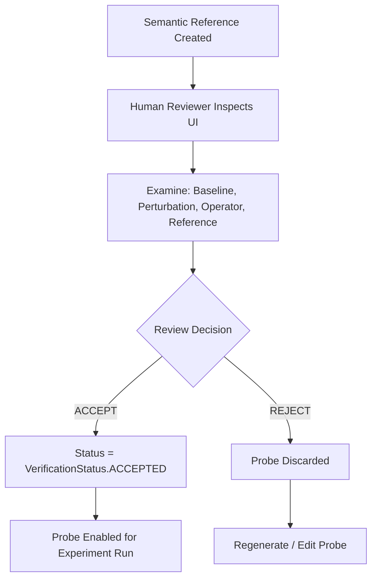
</details>

---

# 6. SEND ACCEPTED PROBE TO EXPERIMENT BENCH

Accepted probes are transferred to the Experiment Bench and scheduled across selected NLP architectures.

### Universal Visual Architecture Diagram
```text
                 ACCEPTED PROBE
                       │
                       ▼
                 Experiment Bench
                       │
                       ▼
             Probe assigned an ID
                       │
                       ▼
             Experiment assigned ID
                       │
                       ▼
           Model(s) selected for test
                       │
             ┌─────────┼─────────┐
             ▼         ▼         ▼
          Model A    Model B    Model C
             │         │         │
             └─────────┼─────────┘
                       ▼
```

### Metadata Structure
```text
Experiment ID:      EXP-1790938891
Probe ID:           PRB-NEG-01
Model IDs:          [albert-base-v2-finetuned-sst2, cardiffnlp/twitter-roberta-base-sentiment-latest]
Explainer:          LIME / SHAP
Probe Category:     NEGATION_INSERTION
Baseline Text:      "The movie was great and the acting was top notch."
Perturbed Text:     "The movie was not great and the acting was top notch."
Semantic Reference: {neg: 0.45, neu: 0.45, pos: 0.10}
Expected Behavior:  Contract A: NEUTRAL | Contract B: NEGATIVE
```

### Execution Matrix
| Step | Component | Responsible File / Function | Inputs | Outputs |
| :--- | :--- | :--- | :--- | :--- |
| **6.1** | Experiment Configuration | [`app.py::render_experiment_runner()`](file:///c:/Dev/Projects/Multimodel/Multimodel_Blindspot-main/blindspot/app.py) | UI Checkboxes | Selected models, explainer list |
| **6.2** | RunPlan Builder | [`types.py::RunPlan`](file:///c:/Dev/Projects/Multimodel/Multimodel_Blindspot-main/blindspot/core/types.py#L60) | Probes, Models, Explainer | Declarative execution specification |
| **6.3** | Scheduler Dispatcher | [`scheduler.py::SequentialScheduler.dispatch()`](file:///c:/Dev/Projects/Multimodel/Multimodel_Blindspot-main/blindspot/execution/scheduler.py#L25) | `RunPlan` | Queued execution steps |

<details>
<summary><b>📊 Click to view Interactive Mermaid Diagram</b></summary>

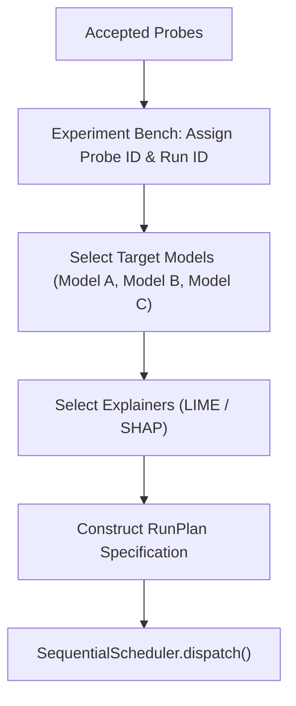
</details>

---

# 7. BASELINE MODEL INFERENCE

Before evaluating perturbation effects, BlindSpot records the model's unperturbed baseline behavior.

### Universal Visual Architecture Diagram
```text
                  Baseline sentence
                         │
                         ▼
                    Model loader
                         │
                         ▼
                   Selected model
                         │
                         ▼
                    Tokenization
                         │
                         ▼
                  Model inference
                         │
                         ▼
             Raw model probabilities
                         │
                         ▼
              Predicted baseline label
```

### Inference Output Example
```text
Input:
"The movie was great and the acting was top notch."

Model output:
POSITIVE: 98.2%
NEGATIVE:  1.8%
```

### Execution Matrix
| Step | Component | Responsible File / Function | Inputs | Outputs |
| :--- | :--- | :--- | :--- | :--- |
| **7.1** | Model Loader / Cache | [`cache.py::ModelCache.get_model()`](file:///c:/Dev/Projects/Multimodel/Multimodel_Blindspot-main/blindspot/models/cache.py#L25) | Model string ID | Loaded HuggingFace pipeline |
| **7.2** | Tokenizer Encoding | [`wrapper.py::HuggingFaceWrapper._tokenize()`](file:///c:/Dev/Projects/Multimodel/Multimodel_Blindspot-main/blindspot/models/wrapper.py#L80) | Baseline string | PyTorch input tensors |
| **7.3** | Forward Pass | [`wrapper.py::HuggingFaceWrapper.predict_result()`](file:///c:/Dev/Projects/Multimodel/Multimodel_Blindspot-main/blindspot/models/wrapper.py#L110) | Tensors (`torch.no_grad`) | Raw logits & softmax probs |
| **7.4** | Canonical Mapping | [`wrapper.py::HuggingFaceWrapper._map_label()`](file:///c:/Dev/Projects/Multimodel/Multimodel_Blindspot-main/blindspot/models/wrapper.py#L145) | Model index | Label: `POSITIVE`, Conf: `0.982` |

<details>
<summary><b>📊 Click to view Interactive Mermaid Diagram</b></summary>

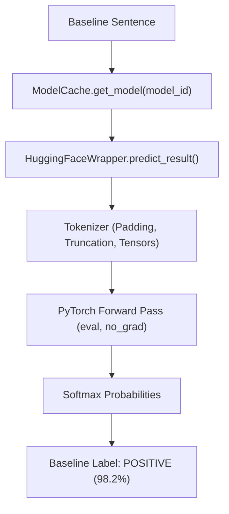
</details>

---

# 8. PERTURBED MODEL INFERENCE

The target model processes the perturbed sentence using the exact same tokenizer parameters and execution context.

### Universal Visual Architecture Diagram
```text
                 Perturbed sentence
                         │
                         ▼
                    Tokenization
                         │
                         ▼
                  Model inference
                         │
                         ▼
             Raw model probabilities
                         │
                         ▼
              Predicted perturbed label
```

### Inference Output Example
```text
Input:
"The movie was not great and the acting was top notch."

Model output:
NEGATIVE: 72.8%
POSITIVE: 27.2%
```

### Execution Matrix
| Step | Component | Responsible File / Function | Inputs | Outputs |
| :--- | :--- | :--- | :--- | :--- |
| **8.1** | Tokenizer Encoding | [`wrapper.py::HuggingFaceWrapper._tokenize()`](file:///c:/Dev/Projects/Multimodel/Multimodel_Blindspot-main/blindspot/models/wrapper.py#L80) | Perturbed text | PyTorch input tensors |
| **8.2** | Forward Pass | [`wrapper.py::HuggingFaceWrapper.predict_result()`](file:///c:/Dev/Projects/Multimodel/Multimodel_Blindspot-main/blindspot/models/wrapper.py#L110) | Input tensors | Perturbed logits & softmax probs |
| **8.3** | Perturbed Prediction Store | [`wrapper.py::HuggingFaceWrapper.predict_results_batch()`](file:///c:/Dev/Projects/Multimodel/Multimodel_Blindspot-main/blindspot/models/wrapper.py#L135) | Batch perturbed texts | Label: `NEGATIVE`, Conf: `0.728` |

<details>
<summary><b>📊 Click to view Interactive Mermaid Diagram</b></summary>

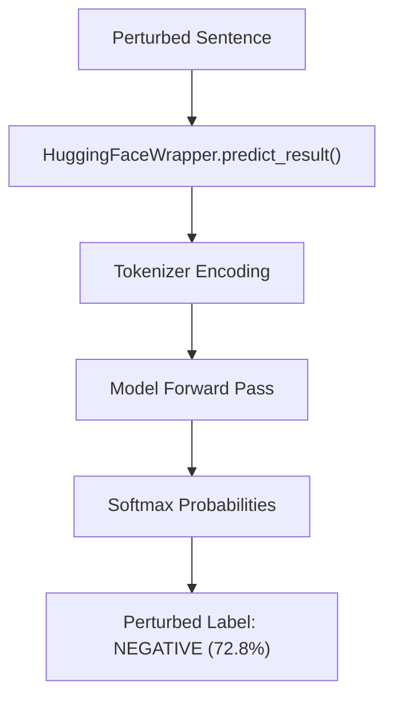
</details>

---

# 9. MODEL CAPABILITY / SEMANTIC CONTRACT

BlindSpot inspects the model's output classes to determine whether to apply Contract A (3-class direct) or Contract B (2-class projection).

### Universal Visual Architecture Diagram
```text
             Model metadata inspected
                       │
                       ▼
                 Number of classes
                       │
              ┌────────┴────────┐
              ▼                 ▼
           2-class            3-class
              │                 │
              ▼                 ▼
       Contract B           Contract A
       projection           direct semantic
              │                 │
              ▼                 ▼
       Binary expected      3-class expected
       polarity             polarity
              │                 │
              └────────┬────────┘
                       ▼
              Expected behavior
```

### Anti-Pattern Prevention
```text
AVOIDED FLAW:
2-class model ──> Expected = NEUTRAL ──> Model cannot emit NEUTRAL ──> False Failure!

BLINDSPOT SOLUTION:
3-class reference ──> 2-class projection ──> Expected NEGATIVE ──> Model outputs NEGATIVE ──> MATCH!
```

### Execution Matrix
| Step | Component | Responsible File / Function | Inputs | Outputs |
| :--- | :--- | :--- | :--- | :--- |
| **9.1** | Capability Inspector | [`behavioral.py::BehavioralTester.evaluate_shared_probes()`](file:///c:/Dev/Projects/Multimodel/Multimodel_Blindspot-main/blindspot/testing/behavioral.py#L65) | `model_wrapper.num_labels` | Number of classes (2 vs 3) |
| **9.2** | Contract A Resolver | [`behavioral.py`](file:///c:/Dev/Projects/Multimodel/Multimodel_Blindspot-main/blindspot/testing/behavioral.py#L85) | `annotation.final_semantic_polarity` | 3-Class Expected Label (`NEUTRAL`) |
| **9.3** | Contract B Resolver | [`behavioral.py`](file:///c:/Dev/Projects/Multimodel/Multimodel_Blindspot-main/blindspot/testing/behavioral.py#L95) | `annotation.two_class_projection["label"]` | Binary Expected Label (`NEGATIVE`) |

<details>
<summary><b>📊 Click to view Interactive Mermaid Diagram</b></summary>

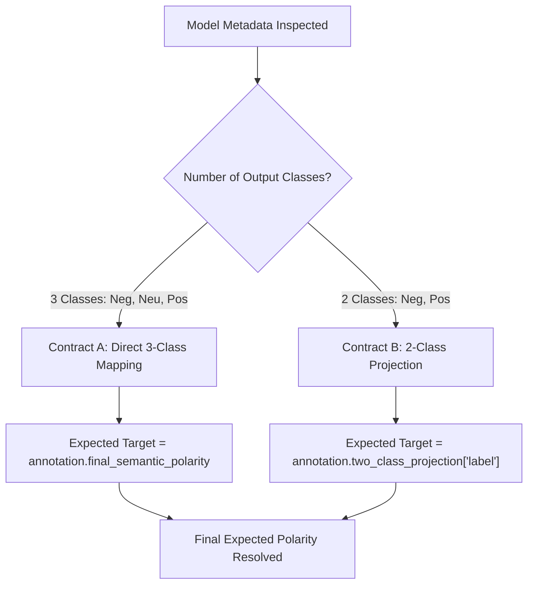
</details>

---

# 10. BEHAVIORAL EVALUATION

Tier 1 behavioral evaluation compares the model's observed transition against the contractual expectation.

### Universal Visual Architecture Diagram
```text
        Baseline prediction
                 │
                 │
                 ▼
        Behavioral evaluator
                 ▲
                 │
        Perturbed prediction
                 │
                 │
        Expected semantic behavior
                 │
                 ▼
```

```text
What was expected?
        VS
What did the model actually do?
```

### Behavioral Outcomes
- `EXPECTED_PRESERVE`: Semantic operation preserves polarity; model retained label (**MATCH**).
- `EXPECTED_FLIP`: Operation expected label transition; model flipped to expected target (**MATCH**).
- `MISSING_FLIP`: Operation required flip; model retained baseline label (**MISMATCH**).
- `UNEXPECTED_FLIP`: Operation expected preserve; model flipped label (**MISMATCH**).
- `POLARITY_REVERSED`: Model flipped, but in the opposite direction of ground truth (**MISMATCH**).

### Execution Matrix
| Step | Component | Responsible File / Function | Inputs | Outputs |
| :--- | :--- | :--- | :--- | :--- |
| **10.1** | Behavioral Evaluator | [`behavioral.py::classify_behavior()`](file:///c:/Dev/Projects/Multimodel/Multimodel_Blindspot-main/blindspot/testing/behavioral.py#L180) | Baseline, Perturbed, Expected | `BehavioralOutcome` enum |
| **10.2** | Behavioral Relation Detector | [`behavioral.py::determine_observed_behavioral_relation()`](file:///c:/Dev/Projects/Multimodel/Multimodel_Blindspot-main/blindspot/testing/behavioral.py#L220) | Observed transitions | Relation string (e.g. `FLIP->FLIP`) |
| **10.3** | Result Packaging | [`types.py::BehavioralResult`](file:///c:/Dev/Projects/Multimodel/Multimodel_Blindspot-main/blindspot/testing/types.py#L30) | Evaluated metrics | Persistable evaluation object |

<details>
<summary><b>📊 Click to view Interactive Mermaid Diagram</b></summary>

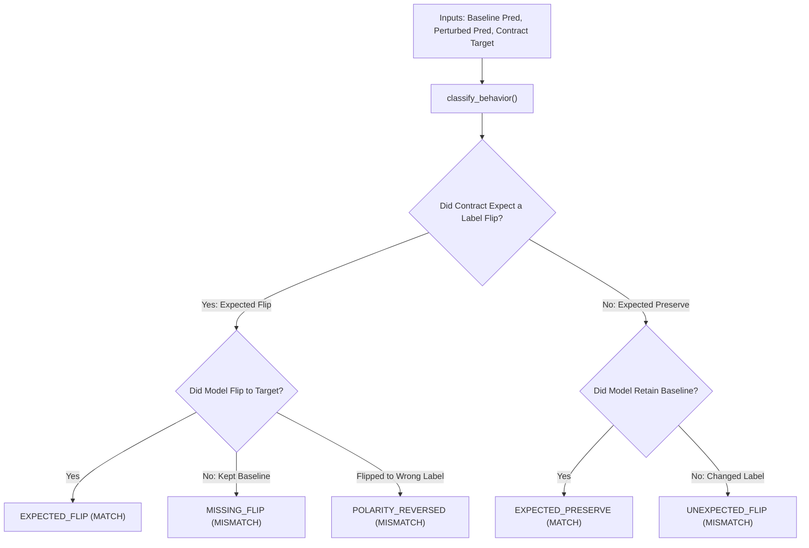
</details>

---

# 11. DETERMINE WHETHER XAI FAILURE ANALYSIS IS REQUIRED

A strict architectural boundary enforces that behavioral successes (`MATCH`) are never passed into failure taxonomy classification.

### Universal Visual Architecture Diagram
```text
             Behavioral outcome
                     │
                     ▼
              Did model behave
              according to contract?
                     │
             ┌───────┴────────┐
             ▼                ▼
           MATCH            MISMATCH
             │                │
             ▼                ▼
       No failure        XAI diagnosis
       taxonomy          required
             │                │
             │                ▼
             │          Explainability
             │          analysis begins
             │
             ▼
```

### Invariant Rule
A behavioral `MATCH` is **never** classified into `BLIND`, `MISWEIGHTED`, or `SPURIOUS` simply because an attribution or confidence score looks unusual.

### Execution Matrix
| Step | Component | Responsible File / Function | Inputs | Outputs |
| :--- | :--- | :--- | :--- | :--- |
| **11.1** | Match Gate Check | [`runner.py::MultimodelExperimentRunner.run_experiment()`](file:///c:/Dev/Projects/Multimodel/Multimodel_Blindspot-main/blindspot/execution/runner.py#L165) | `behavioral_outcome` | Boolean `is_match` |
| **11.2** | Match Action | [`runner.py`](file:///c:/Dev/Projects/Multimodel/Multimodel_Blindspot-main/blindspot/execution/runner.py#L170) | `is_match == True` | `taxonomy = TaxonomyCategory.NONE` |
| **11.3** | Mismatch Action | [`runner.py`](file:///c:/Dev/Projects/Multimodel/Multimodel_Blindspot-main/blindspot/execution/runner.py#L175) | `is_match == False` | Trigger Tier 2 XAI explainer |

<details>
<summary><b>📊 Click to view Interactive Mermaid Diagram</b></summary>

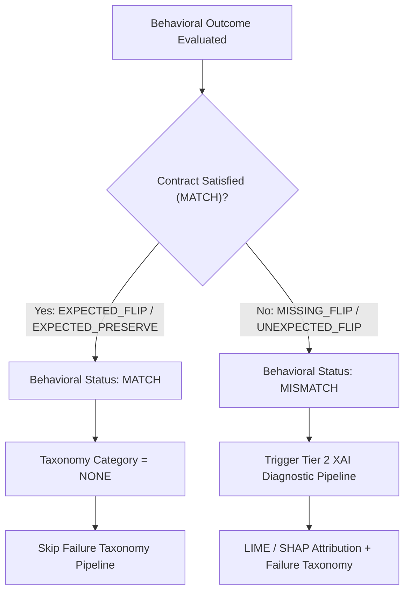
</details>

---

# 12. XAI / EXPLAINABILITY STAGE

For genuine behavioral mismatches, BlindSpot calculates local token-level feature attributions to inspect why the model deviated.

### Universal Visual Architecture Diagram
```text
             Behavioral mismatch
                       │
                       ▼
                XAI explainer
                       │
              ┌────────┼────────┐
              ▼        ▼        ▼
             LIME     SHAP    Other
                       │
                       ▼
               Attribution run
                       │
                       ▼
          Token-level attribution
```

### Example Token Attribution
```text
Input: "The movie was not great and the acting was top notch."

Token attribution:
not        -0.02
great      -0.32
acting     +0.04
top        +0.18
notch      +0.11
```

### Execution Matrix
| Step | Component | Responsible File / Function | Inputs | Outputs |
| :--- | :--- | :--- | :--- | :--- |
| **12.1** | LIME Explainer | [`lime_explainer.py::LIMEExplainer.explain()`](file:///c:/Dev/Projects/Multimodel/Multimodel_Blindspot-main/blindspot/explainability/lime_explainer.py#L35) | Perturbed text, model `predict_proba` | `WordAttributionResult` |
| **12.2** | SHAP Explainer | [`shap_explainer.py::SHAPExplainer.explain()`](file:///c:/Dev/Projects/Multimodel/Multimodel_Blindspot-main/blindspot/explainability/shap_explainer.py#L35) | Perturbed text, model pipeline | Shapley values per token |
| **12.3** | Probability Probe | [`wrapper.py::HuggingFaceWrapper.predict_proba()`](file:///c:/Dev/Projects/Multimodel/Multimodel_Blindspot-main/blindspot/models/wrapper.py#L160) | Perturbed string samples | Probability matrix `(N, C)` |

<details>
<summary><b>📊 Click to view Interactive Mermaid Diagram</b></summary>

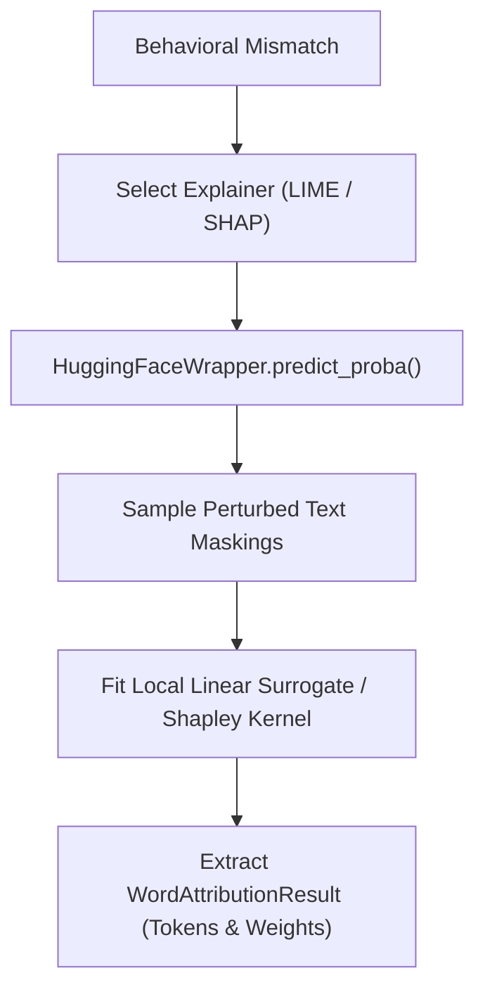
</details>

---

# 13. TOKEN / OPERATOR ANALYSIS

BlindSpot isolates the specific linguistic operator token and measures its attribution magnitude against the project threshold.

### Universal Visual Architecture Diagram
```text
                 Token attributions
                         │
                         ▼
                Token classification
                         │
            ┌────────────┼────────────┐
            ▼            ▼            ▼
          Operator      Content      Background
            │            │            │
            ▼            ▼            ▼
        negation       sentiment     context
        contrast       words         words
        connective
            │
            ▼
      Attribution magnitude
            │
            ▼
       Compare threshold
```

### Operational Threshold Rule
```text
|attribution| < 0.05   ──> Candidate for BLIND operator
|attribution| >= 0.05  ──> Operator received substantive weight
```

### Execution Matrix
| Step | Component | Responsible File / Function | Inputs | Outputs |
| :--- | :--- | :--- | :--- | :--- |
| **13.1** | Lexical Classifier | [`taxonomy.py::TaxonomyClassifier._classify_tokens()`](file:///c:/Dev/Projects/Multimodel/Multimodel_Blindspot-main/blindspot/explainability/taxonomy.py#L80) | Token list | Partitioned operator vs content tokens |
| **13.2** | Magnitude Computer | [`taxonomy.py::TaxonomyClassifier._get_operator_weight()`](file:///c:/Dev/Projects/Multimodel/Multimodel_Blindspot-main/blindspot/explainability/taxonomy.py#L110) | Attributions, Operator token | Scalar float weight $w_{\text{op}}$ |
| **13.3** | Threshold Evaluation | [`taxonomy.py`](file:///c:/Dev/Projects/Multimodel/Multimodel_Blindspot-main/blindspot/explainability/taxonomy.py#L125) | $\|w_{\text{op}}\|$ vs $0.05$ | Boolean indicator |

<details>
<summary><b>📊 Click to view Interactive Mermaid Diagram</b></summary>

```mermaid
graph TD
    A["Token Attributions"] --> B["Token Classification: Operator vs Content vs Context"]
    B --> C["Isolate Operator Token: op_token (e.g., 'not')"]
    C --> D["Extract Weight: w_op = attributions.get(op_token, 0.0)"]
    D --> E{"Compare Magnitude: |w_op| < 0.05?"}
    E -->|True: |w_op| < 0.05| F["Operator Ignored: Evidence for BLIND"]
    E -->|False: |w_op| >= 0.05| G["Operator Weighted: Candidate for MISWEIGHTED"]
```
</details>

---

# 14. FAILURE TAXONOMY

For genuine behavioral mismatches, BlindSpot assigns the failure to one of four mutually exclusive taxonomy categories.

### Universal Visual Architecture Diagram
```text
                 Behavioral mismatch
                         │
                         ▼
                Taxonomy classifier
                         │
            ┌────────────┼────────────┐
            ▼            ▼            ▼
          BLIND       MISWEIGHTED   SPURIOUS
            │            │            │
            └────────────┼────────────┘
                         │
                         ▼
                    UNDETERMINED
                  when evidence is
                    insufficient
```

### 1. BLIND
```text
Important semantic operator + very low attribution (|w| < 0.05) ──> BLIND
Example: "not", attribution = -0.02, |-0.02| < 0.05
```

### 2. MISWEIGHTED
```text
Important operator recognized (|w| >= 0.05), but weighting/behavior is inconsistent with expected semantic behavior ──> MISWEIGHTED
```

### 3. SPURIOUS
```text
Behavioral mismatch, semantic operator is not sufficient explanation, irrelevant/background features carry influential attribution ──> SPURIOUS
```

### 4. UNDETERMINED
```text
Behavioral mismatch where available attribution evidence doesn't establish a reliable diagnostic mechanism (insufficient evidence) ──> UNDETERMINED
```

### Execution Matrix
| Step | Component | Responsible File / Function | Inputs | Outputs |
| :--- | :--- | :--- | :--- | :--- |
| **14.1** | Taxonomy Classifier | [`taxonomy.py::TaxonomyClassifier.classify_failure()`](file:///c:/Dev/Projects/Multimodel/Multimodel_Blindspot-main/blindspot/explainability/taxonomy.py#L30) | Behavioral outcome, Attributions, Operator | `TaxonomyCategory` enum |
| **14.2** | Blind Rule Evaluator | [`taxonomy.py`](file:///c:/Dev/Projects/Multimodel/Multimodel_Blindspot-main/blindspot/explainability/taxonomy.py#L65) | Operator present and $\|w\| < 0.05$ | `TaxonomyCategory.BLIND` |
| **14.3** | Spurious Rule Evaluator | [`taxonomy.py`](file:///c:/Dev/Projects/Multimodel/Multimodel_Blindspot-main/blindspot/explainability/taxonomy.py#L75) | Context weights $> 2 \times$ operator | `TaxonomyCategory.SPURIOUS` |
| **14.4** | Misweighted Evaluator | [`taxonomy.py`](file:///c:/Dev/Projects/Multimodel/Multimodel_Blindspot-main/blindspot/explainability/taxonomy.py#L85) | Operator $\|w\| \ge 0.05$ with mismatch | `TaxonomyCategory.MISWEIGHTED` |
| **14.5** | Undetermined Fallback | [`taxonomy.py`](file:///c:/Dev/Projects/Multimodel/Multimodel_Blindspot-main/blindspot/explainability/taxonomy.py#L95) | Inconclusive diagnostic evidence | `TaxonomyCategory.UNDETERMINED` |

<details>
<summary><b>📊 Click to view Interactive Mermaid Diagram</b></summary>

```mermaid
graph TD
    A["Behavioral Mismatch"] --> B["TaxonomyClassifier"]
    B --> C{"Is Operator Present & |w_op| < 0.05?"}
    C -->|Yes| D["BLIND (Model ignored semantic operator)"]
    
    C -->|No: |w_op| >= 0.05| E{"Did Background / Context Tokens Dominate?"}
    E -->|Yes: Context > 2x Operator| F["SPURIOUS (Dominated by irrelevant features)"]
    E -->|No: Operator substantive but wrong outcome| G["MISWEIGHTED (Inconsistent weighting)"]
    
    C -->|Operator Not Found / Indeterminate| H["UNDETERMINED (Diagnostic evidence insufficient)"]
```
</details>

---

# 15. FAILURE EVIDENCE GENERATION

Once classified, BlindSpot constructs an evidence bundle and conducts controlled counterfactual validation.

### Universal Visual Architecture Diagram
```text
                 Failure category
                         │
                         ▼
                  Evidence builder
                         │
              ┌──────────┼──────────┐
              ▼          ▼          ▼
          Behavioral   Attribution  Semantic
            evidence    evidence    evidence
              │          │          │
              └──────────┼──────────┘
                         ▼
                    Explanation
                         │
                         ▼
                    Rationale
```

### Complete Diagnostic Lineage Chain
```text
Probe ──> Semantic Reference ──> Expected Behavior ──> Baseline Output ──> Perturbed Output ──> Behavioral Outcome ──> Attribution ──> Failure Taxonomy ──> Evidence ──> Rationale
```

### Execution Matrix
| Step | Component | Responsible File / Function | Inputs | Outputs |
| :--- | :--- | :--- | :--- | :--- |
| **15.1** | Counterfactual Synthesizer | [`runner.py::MultimodelExperimentRunner.run_experiment()`](file:///c:/Dev/Projects/Multimodel/Multimodel_Blindspot-main/blindspot/execution/runner.py#L195) | Perturbed text minus operator token | Counterfactual text $T_{\text{cf}}$ |
| **15.2** | Counterfactual Forward Pass | [`wrapper.py::HuggingFaceWrapper.predict_proba()`](file:///c:/Dev/Projects/Multimodel/Multimodel_Blindspot-main/blindspot/models/wrapper.py#L160) | `[seed_t, pert_t, cf_text]` | Probability vector delta $\Delta p$ |
| **15.3** | Evidence Packager | [`taxonomy.py::FailureDiagnosis`](file:///c:/Dev/Projects/Multimodel/Multimodel_Blindspot-main/blindspot/explainability/taxonomy.py#L20) | Category, attributions, $\Delta p$ | Serialized `FailureDiagnosis` |

<details>
<summary><b>📊 Click to view Interactive Mermaid Diagram</b></summary>

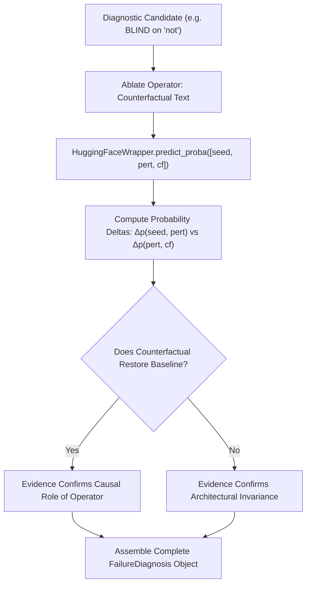
</details>

---

# 16. TOKEN HIGHLIGHTING / UI VISUALIZATION

The presentation layer renders diagnostic results in the Streamlit UI, strictly enforcing token status decoupling.

### Universal Visual Architecture Diagram
```text
                  Diagnostic result
                         │
                         ▼
                 Token renderer
                         │
                         ▼
             Compare baseline/perturbed
                         │
                         ▼
                  Token alignment
                         │
                         ▼
              Determine token status
                         │
        ┌────────────────┼────────────────┐
        ▼                ▼                ▼
      BLINDED          NORMAL         INSERTED
        │                │                │
        ▼                ▼                ▼
    Red highlight     Normal          Normal
    + BLINDED         attribution     insertion
    label             display         formatting
```

### Crucial Decoupling Rule
```text
Inserted token ≠ Blinded token
Example: "bad" = -0.32 must NOT become [BLINDED: -0.32] merely because it was inserted!
```

### Execution Matrix
| Step | Component | Responsible File / Function | Inputs | Outputs |
| :--- | :--- | :--- | :--- | :--- |
| **16.1** | Token Alignment & Shading | [`components.py::_analyze_and_highlight_tokens()`](file:///c:/Dev/Projects/Multimodel/Multimodel_Blindspot-main/blindspot/ui/components.py#L420) | Attributions, Category, Operator | HTML spans with background opacity |
| **16.2** | Blind Tag Formatter | [`components.py`](file:///c:/Dev/Projects/Multimodel/Multimodel_Blindspot-main/blindspot/ui/components.py#L455) | Token is operator AND $\|w\| < 0.05$ | `.pill-blind` span with `[BLINDED]` |
| **16.3** | Matrix Match Highlight | [`comparison.py::render_comparison_matrix()`](file:///c:/Dev/Projects/Multimodel/Multimodel_Blindspot-main/blindspot/ui/comparison.py#L85) | `MISWEIGHTED` with valid relation | `.cell-misweighted-match` styling |
| **16.4** | Diagnostic Card | [`components.py::render_failure_diagnostic_card()`](file:///c:/Dev/Projects/Multimodel/Multimodel_Blindspot-main/blindspot/ui/components.py#L220) | `FailureDiagnosis` | Formatted evidence UI card |

<details>
<summary><b>📊 Click to view Interactive Mermaid Diagram</b></summary>

```mermaid
graph TD
    A["Diagnostic Result to UI"] --> B["components.py::_analyze_and_highlight_tokens()"]
    B --> C["Token Alignment & Operator Detection"]
    
    C --> D{"Is Token the Identified Blind Operator?"}
    D -->|Yes: category == 'Blind' and |w| < 0.05| E["Render [BLINDED] with Red Tag (.pill-blind)"]
    D -->|No: Normal Token or Perturbation Insertion| F{"Token Attribution Weight Direction?"}
    
    F -->|Positive Weight| G["Render Green Intensity Shading"]
    F -->|Negative Weight| H["Render Red Intensity Shading"]
    
    B --> I["comparison.py::render_comparison_matrix()"]
    I --> J{"Result Category?"}
    J -->|MISWEIGHTED with Valid Behavioral Match| K["Render Neon-Green Style: .cell-misweighted-match"]
    J -->|True Failure (BLIND / SPURIOUS)| L["Render Deep Warning Style: .cell-fail"]
```
</details>

---

# 17. EXPERIMENT RESULT STORAGE

Experiments are persisted to disk as immutable JSON artifacts in structured run directories.

### Universal Visual Architecture Diagram
```text
                  Experiment result
                         │
                         ▼
                  Result serializer
                         │
                         ▼
                  Experiment JSON
                         │
             ┌───────────┼───────────┐
             ▼           ▼           ▼
          Metadata    Predictions   XAI
             │           │           │
             ▼           ▼           ▼
          Probe ID    Baseline      Tokens
          Model ID    Perturbed     weights
          Run ID      Expected      evidence
          timestamps  Actual        taxonomy
                         │
                         ▼
                    Run directory
```

### Run Directory Layout
```text
runs/
└── EXP-1790938891/
    ├── run_plan.json               # Models, explainers, probe count
    ├── semantic_reference.json     # Ground truth references & human verification status
    ├── results.json                # Predictions, behavioral outcomes, XAI attributions
    └── report.md                   # Auto-generated comprehensive Markdown report
```

### Execution Matrix
| Step | Component | Responsible File / Function | Inputs | Outputs |
| :--- | :--- | :--- | :--- | :--- |
| **17.1** | Directory Allocator | [`run_store.py::RunStore._get_run_dir()`](file:///c:/Dev/Projects/Multimodel/Multimodel_Blindspot-main/blindspot/storage/run_store.py#L40) | Run ID string | Path `runs/<run_id>/` |
| **17.2** | Plan Serializer | [`run_store.py::RunStore.save_run()`](file:///c:/Dev/Projects/Multimodel/Multimodel_Blindspot-main/blindspot/storage/run_store.py#L50) | `RunPlan` object | `run_plan.json` |
| **17.3** | Ground Truth Serializer | [`run_store.py`](file:///c:/Dev/Projects/Multimodel/Multimodel_Blindspot-main/blindspot/storage/run_store.py#L60) | `SemanticReferenceSet` | `semantic_reference.json` |
| **17.4** | Results Serializer | [`run_store.py`](file:///c:/Dev/Projects/Multimodel/Multimodel_Blindspot-main/blindspot/storage/run_store.py#L70) | `ExperimentResult` | `results.json` |

<details>
<summary><b>📊 Click to view Interactive Mermaid Diagram</b></summary>

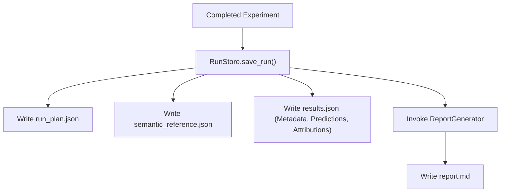
</details>

---

# 18. RUN / EXPERIMENT REPORT GENERATION

Completed experiments are aggregated into cross-model and cross-probe summary statistics.

### Universal Visual Architecture Diagram
```text
                 Completed experiment
                         │
                         ▼
                  Report generator
                         │
                         ▼
              Aggregate probe results
                         │
                         ▼
             Aggregate model results
                         │
                         ▼
           Calculate diagnostic statistics
                         │
             ┌───────────┼───────────┐
             ▼           ▼           ▼
          Matches     Failures      XAI
             │           │           │
             ▼           ▼           ▼
          counts      taxonomy     attribution
          rates       counts       summaries
                         │
                         ▼
                  Report structure
```

### Execution Matrix
| Step | Component | Responsible File / Function | Inputs | Outputs |
| :--- | :--- | :--- | :--- | :--- |
| **18.1** | Cross-Model Aggregator | [`cross_model.py::CrossModelAnalyzer.compute_metrics()`](file:///c:/Dev/Projects/Multimodel/Multimodel_Blindspot-main/blindspot/analysis/cross_model.py#L25) | `ExperimentResult` | Metric summaries, pass rates |
| **18.2** | Vulnerability Profiler | [`cross_model.py::CrossModelAnalyzer.build_vulnerability_matrix()`](file:///c:/Dev/Projects/Multimodel/Multimodel_Blindspot-main/blindspot/analysis/cross_model.py#L65) | Model outputs | Probe-by-model vulnerability grid |
| **18.3** | Agreement Metric | [`cross_model.py::CrossModelAnalyzer.compute_inter_model_agreement()`](file:///c:/Dev/Projects/Multimodel/Multimodel_Blindspot-main/blindspot/analysis/cross_model.py#L110) | Predictions | Concordance / Cohen's Kappa |

<details>
<summary><b>📊 Click to view Interactive Mermaid Diagram</b></summary>

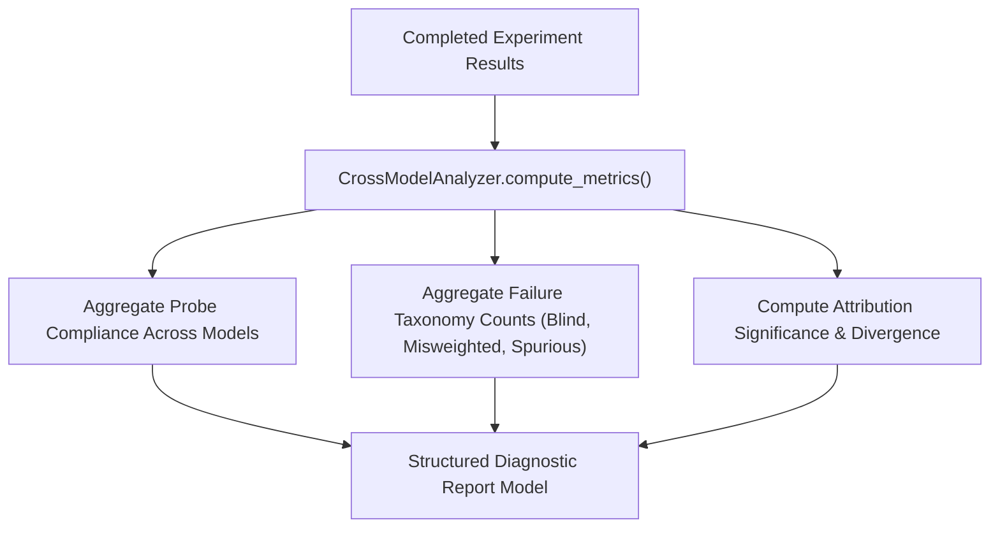
</details>

---

# 19. MARKDOWN REPORT GENERATION

The structured report model is transformed into a publication-ready Markdown artifact.

### Universal Visual Architecture Diagram
```text
                  Experiment data
                         │
                         ▼
                  Markdown builder
                         │
                         ▼
              Generate report sections
                         │
        ┌────────────────┼─────────────────┐
        ▼                ▼                 ▼
     Overview         Models             Probes
        │                │                 │
        ▼                ▼                 ▼
    Experiment       Predictions      Probe results
    metadata         statistics       behavioral
                                      results
                         │
                         ▼
              Probe-level diagnostics
                         │
                         ▼
             Semantic reference
                         │
                         ▼
             Expected behavior
                         │
                         ▼
              Actual behavior
                         │
                         ▼
              Behavioral outcome
                         │
                         ▼
             XAI diagnosis
                         │
                         ▼
            Token attribution
                         │
                         ▼
             Failure evidence
                         │
                         ▼
                Final rationale
```

### Execution Matrix
| Step | Component | Responsible File / Function | Inputs | Outputs |
| :--- | :--- | :--- | :--- | :--- |
| **19.1** | Report Pipeline Orchestrator | [`report_generator.py::ReportGenerator.generate_markdown_report()`](file:///c:/Dev/Projects/Multimodel/Multimodel_Blindspot-main/blindspot/reporting/report_generator.py#L25) | Results, Plan, Semantics | Complete markdown string |
| **19.2** | Header Builder | [`report_generator.py::_generate_header()`](file:///c:/Dev/Projects/Multimodel/Multimodel_Blindspot-main/blindspot/reporting/report_generator.py#L65) | Metadata | Markdown Title & Timestamps |
| **19.3** | Table Builder | [`report_generator.py::_generate_model_comparison_matrix()`](file:///c:/Dev/Projects/Multimodel/Multimodel_Blindspot-main/blindspot/reporting/report_generator.py#L110) | Predictions | Markdown comparative table |
| **19.4** | Forensic Section Builder | [`report_generator.py::_generate_detailed_diagnostics()`](file:///c:/Dev/Projects/Multimodel/Multimodel_Blindspot-main/blindspot/reporting/report_generator.py#L160) | Attributions, Diagnoses | Token weights, evidence bullets |

<details>
<summary><b>📊 Click to view Interactive Mermaid Diagram</b></summary>

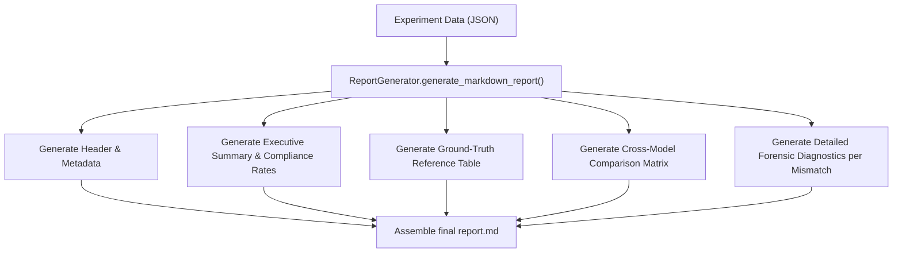
</details>

---

# 20. FINAL MARKDOWN REPORT

Below is the concrete structure of the generated report for both a behavioral `MATCH` and an identified failure:

### Report Example: Behavioral MATCH
```markdown
# BlindSpot Experiment Report

## Experiment
Experiment ID: EXP-1790938891
Date: 2026-10-02T11:06:09Z
Models: albert-base-v2-finetuned-sst2, cardiffnlp/twitter-roberta-base-sentiment-latest
Probe set: PRB-NEG-01

---

## Semantic Reference
Baseline:  "The movie was great and the acting was top notch."
Perturbed: "The movie was not great and the acting was top notch."
Probe:     NEGATION_INSERTION

Semantic Reference Probabilities:
- Negative: 0.45
- Neutral:  0.45
- Positive: 0.10

---

## Expected Behavior
3-class Contract A: NEUTRAL
2-class Contract B: NEGATIVE

---

## Model Result: RoBERTa Sentiment (3-Class)
Baseline:  POSITIVE (0.98)
Perturbed: NEUTRAL  (0.52)
Expected:  NEUTRAL
Behavior:  MATCH (EXPECTED_FLIP)

---

## Explainability
No primary XAI failure because behavioral contract was satisfied.

---

## Diagnostic Summary
Behavioral status: MATCH
Failure category:  NONE
```

### Report Example: Behavioral Failure (BLIND)
```markdown
## Failure Diagnosis: ALBERT SST-2 (2-Class)

Behavior:         MISSING_FLIP
Failure category: BLIND

### Evidence
Operator:            not
Attribution:         -0.0124
Threshold:           0.05
Absolute magnitude:  0.0124 < 0.05 (True)

### Interpretation
The expected semantic operator received insufficient attribution according to the configured diagnostic threshold (|w| < 0.05). Counterfactual ablation confirms the model's positive classification remained unaffected by the presence of negation.
```

---

# 21. COMPLETE SYSTEM FLOW

The full end-to-end architecture flow uniting all 20 stages:

### Master System Flowchart
```text
┌──────────────────────────────┐
│     RUN POWERSHELL SCRIPT    │
└──────────────┬───────────────┘
               │
               ▼
┌──────────────────────────────┐
│          app.py              │
│      application startup     │
└──────────────┬───────────────┘
               │
               ▼
┌──────────────────────────────┐
│       Web server starts      │
└──────────────┬───────────────┘
               │
               ▼
┌──────────────────────────────┐
│       Browser opens          │
└──────────────┬───────────────┘
               │
               ▼
┌──────────────────────────────┐
│   Probe Generation Workbench │
└──────────────┬───────────────┘
               │
               ▼
┌──────────────────────────────┐
│   User enters baseline       │
│   sentence                   │
└──────────────┬───────────────┘
               │
               ▼
┌──────────────────────────────┐
│     Select probe operation   │
└──────────────┬───────────────┘
               │
               ▼
┌──────────────────────────────┐
│       Probe generator        │
└──────────────┬───────────────┘
               │
               ▼
┌──────────────────────────────┐
│ Baseline + Perturbed pair    │
└──────────────┬───────────────┘
               │
               ▼
┌──────────────────────────────┐
│       Gemini API call        │
│                              │
│ Input:                       │
│ • baseline                   │
│ • perturbation               │
│ • probe operation            │
│ • semantic instructions      │
└──────────────┬───────────────┘
               │
               ▼
┌──────────────────────────────┐
│      Gemini semantic         │
│         response             │
│                              │
│ • neg probability            │
│ • neutral probability        │
│ • pos probability            │
│ • semantic interpretation    │
└──────────────┬───────────────┘
               │
               ▼
┌──────────────────────────────┐
│      Parse + validate        │
│      semantic reference      │
└──────────────┬───────────────┘
               │
               ▼
┌──────────────────────────────┐
│       HUMAN REVIEW           │
└──────────────┬───────────────┘
               │
          ┌────┴────┐
          │         │
       REJECT     ACCEPT
          │         │
          ▼         ▼
      Regenerate   Experiment
                    Bench
                      │
                      ▼
             ┌─────────────────┐
             │ Select model(s) │
             └────────┬────────┘
                      │
                      ▼
             ┌─────────────────┐
             │ Load model      │
             └────────┬────────┘
                      │
                      ▼
             ┌─────────────────┐
             │ BASELINE        │
             │ inference       │
             └────────┬────────┘
                      │
                      ▼
             ┌─────────────────┐
             │ PERTURBED       │
             │ inference       │
             └────────┬────────┘
                      │
                      ▼
             ┌─────────────────┐
             │ Model capability│
             │ 2-class /       │
             │ 3-class         │
             └────────┬────────┘
                      │
                      ▼
             ┌─────────────────┐
             │ Semantic        │
             │ Contract        │
             │ evaluation      │
             └────────┬────────┘
                      │
                      ▼
             ┌─────────────────┐
             │ Expected vs     │
             │ Actual          │
             └────────┬────────┘
                      │
                ┌─────┴─────┐
                │           │
              MATCH      MISMATCH
                │           │
                ▼           ▼
           No primary     XAI
           failure       analysis
                            │
                            ▼
                     ┌─────────────┐
                     │ Explainer   │
                     │ LIME/SHAP   │
                     └──────┬──────┘
                            │
                            ▼
                     Token attribution
                            │
                            ▼
                     Operator analysis
                            │
                            ▼
                     Threshold analysis
                            │
                            ▼
                     Failure taxonomy
                            │
                 ┌──────────┼──────────┐
                 ▼          ▼          ▼
               BLIND   MISWEIGHTED  SPURIOUS
                 │          │          │
                 └──────────┼──────────┘
                            │
                            ▼
                      UNDETERMINED
                      if evidence
                      insufficient
                            │
                            ▼
                     Evidence builder
                            │
                            ▼
                     Rationale builder
                            │
                            ▼
                     Diagnostic result
                            │
                            ▼
                     UI token renderer
                            │
              ┌─────────────┼──────────────┐
              ▼             ▼              ▼
          BLINDED         NORMAL        INSERTED
          token           token         token
              │             │              │
              ▼             ▼              ▼
          red only      normal XAI     normal insertion
          if actual     rendering      rendering
          blind
                            │
                            ▼
                     Result serialization
                            │
                            ▼
                     Experiment JSON
                            │
                            ▼
                     Run artifacts
                            │
                            ▼
                     Report generator
                            │
                            ▼
                  Markdown report (.md)
                            │
                            ▼
┌──────────────────────────────────────────────┐
│              FINAL BLINDSPOT REPORT          │
│                                              │
│ • Experiment metadata                        │
│ • Probe information                          │
│ • Semantic references                        │
│ • Human verification                         │
│ • Model predictions                          │
│ • Expected behavior                          │
│ • Actual behavior                            │
│ • Behavioral outcome                         │
│ • XAI attribution                            │
│ • Failure taxonomy                           │
│ • Evidence                                   │
│ • Diagnostic rationale                       │
│ • Per-model/per-probe summaries              │
└──────────────────────────────────────────────┘
```

<details>
<summary><b>📊 Click to view Complete Master Sequence Diagram (Mermaid)</b></summary>

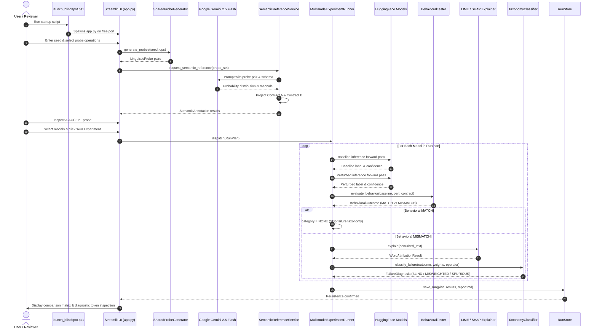
</details>

---

# 22. THE MOST IMPORTANT ARCHITECTURAL SEPARATION

The BlindSpot architecture enforces a strict separation into **four distinct layers**:

### Four Distinct Layers Flow
```text
                 BLINDSPOT
                    │
        ┌───────────┼───────────┐
        │           │           │
        ▼           ▼           ▼
   SEMANTICS    BEHAVIOR       XAI
        │           │           │
        │           │           ▼
        │           │       TAXONOMY
        │           │           │
        │           │      BLIND / etc.
        │           │
        ▼           ▼
 Gemini reference   Expected
 + human review     vs actual
                    │
                    ▼
                 MATCH /
                MISMATCH
```

### Linear Pipeline Dependencies
```text
SEMANTIC CONTRACT
       ↓
EXPECTED BEHAVIOR
       ↓
MODEL OUTPUT
       ↓
BEHAVIORAL RESULT
       ↓
ONLY IF MISMATCH
       ↓
XAI ANALYSIS
       ↓
FAILURE TAXONOMY
       ↓
EVIDENCE
       ↓
UI
       ↓
JSON ARTIFACTS
       ↓
MARKDOWN REPORT
```

### Architectural Separation Matrix
| Layer | Scope | Primary Question Answered | Failure Modes Handled | Core Code File |
| :--- | :--- | :--- | :--- | :--- |
| **Layer 1: Semantics** | Ground Truth & Contracts | *What does the text mean and what should any capable model predict?* | Human rejection, hallucinated polarity | [`service.py`](file:///c:/Dev/Projects/Multimodel/Multimodel_Blindspot-main/blindspot/semantic/service.py), [`client.py`](file:///c:/Dev/Projects/Multimodel/Multimodel_Blindspot-main/blindspot/semantic/client.py) |
| **Layer 2: Behavior** | Multi-Model Execution | *Did the model output match the contractually expected behavior?* | Missing flip, unexpected flip, reversal | [`behavioral.py`](file:///c:/Dev/Projects/Multimodel/Multimodel_Blindspot-main/blindspot/testing/behavioral.py), [`wrapper.py`](file:///c:/Dev/Projects/Multimodel/Multimodel_Blindspot-main/blindspot/models/wrapper.py) |
| **Layer 3: XAI & Taxonomy** | Failure Forensics | *Why did the model deviate from the behavioral contract?* | Blindness, misweighting, spurious correlations | [`taxonomy.py`](file:///c:/Dev/Projects/Multimodel/Multimodel_Blindspot-main/blindspot/explainability/taxonomy.py), [`lime_explainer.py`](file:///c:/Dev/Projects/Multimodel/Multimodel_Blindspot-main/blindspot/explainability/lime_explainer.py) |
| **Layer 4: Artifacts & UI** | Presentation & Persistence | *How are diagnostic findings rendered, shared, and stored?* | Misleading highlighting, unverified runs | [`components.py`](file:///c:/Dev/Projects/Multimodel/Multimodel_Blindspot-main/blindspot/ui/components.py), [`run_store.py`](file:///c:/Dev/Projects/Multimodel/Multimodel_Blindspot-main/blindspot/storage/run_store.py) |

<details>
<summary><b>📊 Click to view Layer Separation Diagram (Mermaid)</b></summary>

```mermaid
graph TD
    subgraph "LAYER 1: SEMANTICS"
        L1A["Linguistic Perturbation"] --> L1B["Gemini Semantic Reference"]
        L1B --> L1C["Human Review Gate"]
        L1C --> L1D["Dual-Contract Resolution (Contract A / B)"]
    end
    
    subgraph "LAYER 2: BEHAVIOR"
        L2A["Baseline Inference"] --> L2B["Perturbed Inference"]
        L2B --> L2C["Contractual Behavioral Outcome (MATCH vs MISMATCH)"]
    end
    
    subgraph "LAYER 3: EXPLAINABILITY & TAXONOMY"
        L3A["Attribution Extraction (LIME/SHAP)"] --> L3B["Operator Magnitude Check (|w| < 0.05)"]
        L3B --> L3C["Counterfactual Validation"]
        L3C --> L3D["Taxonomy Classification (BLIND/MISWEIGHTED/SPURIOUS)"]
    end
    
    subgraph "LAYER 4: ARTIFACTS & PRESENTATION"
        L4A["Decoupled Token Rendering (Red vs Green vs Normal)"] --> L4B["Neon-Green MISWEIGHTED Match Badge"]
        L4B --> L4C["Immutable Run Storage (JSON)"]
        L4C --> L4D["Markdown Report Synthesis"]
    end
    
    L1D ==>|Yields Expected Polarity| L2C
    L2C ==>|Triggered ONLY on MISMATCH| L3A
    L3D ==>|Supplies Diagnosis| L4A
```
</details>

### The Three Cardinal System Invariants
1. **The Contract Invariant**: A 2-class model must **never** be failed because it cannot emit `NEUTRAL`. Contract B projects 3-class semantic probability mass into binary target space.
2. **The Behavioral Gate Invariant**: A behavioral `MATCH` is complete and final. It must **never** be converted into a primary XAI failure (`BLIND`, `MISWEIGHTED`, `SPURIOUS`) just because its confidence or attribution looks unusual.
3. **The Attribution Decoupling Invariant**: An inserted perturbation token is **not** inherently a blinded token. The UI must render `[BLINDED]` if and only if the token is an operator whose absolute attribution satisfies $|w_{\text{op}}| < 0.05$.
