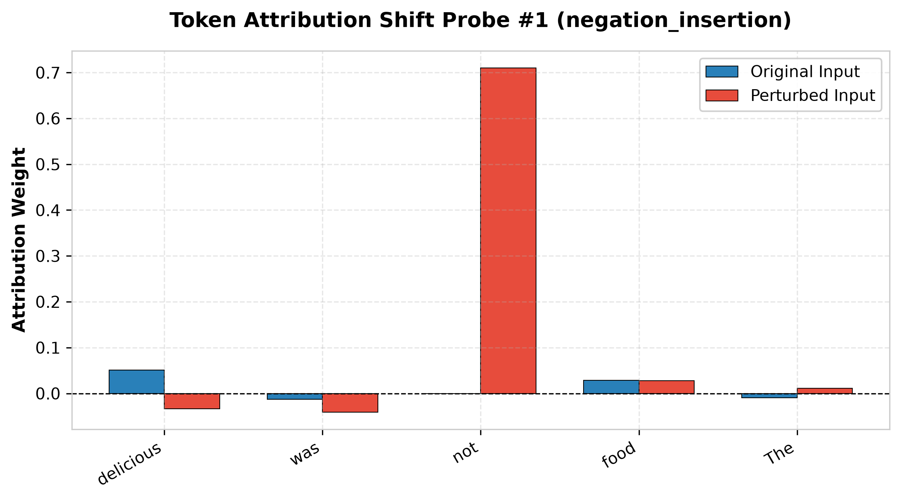
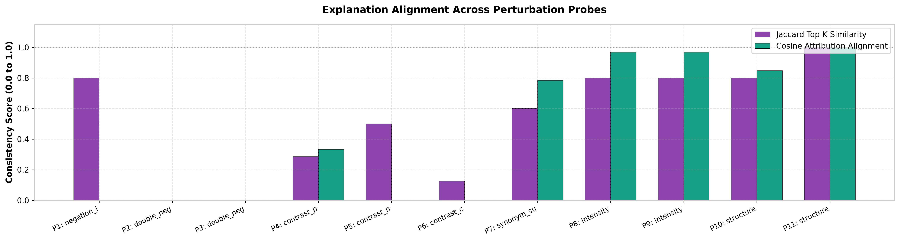

# Explanation Comparison Report

This report details local token feature attributions (LIME & SHAP) compared between original and perturbed inputs.

## Detailed Probe Feature Attributions

### Probe #1: negation_insertion
- **Original Input**: "The food was delicious."
- **Perturbed Input**: "The food was not delicious."
- **Jaccard Attribution Similarity**: 0.8000
- **Cosine Attribution Alignment**: -0.0118

**Top Token Attributions (Perturbed)**:
  - `not`: +0.7101
  - `was`: -0.0407
  - `delicious`: -0.0337
  - `food`: +0.0278
  - `The`: +0.0110

----------------------------------------

### Probe #2: double_negation
- **Original Input**: "The food was delicious."
- **Perturbed Input**: "It is not impossible that the food was delicious."
- **Jaccard Attribution Similarity**: 0.0000
- **Cosine Attribution Alignment**: -0.1193

**Top Token Attributions (Perturbed)**:
  - `impossible`: +0.4774
  - `not`: -0.1706
  - `is`: +0.1540
  - `that`: +0.0979
  - `It`: -0.0974

----------------------------------------

### Probe #3: double_negation
- **Original Input**: "The food was delicious."
- **Perturbed Input**: "It is not untrue that the food was delicious."
- **Jaccard Attribution Similarity**: 0.0000
- **Cosine Attribution Alignment**: -0.1065

**Top Token Attributions (Perturbed)**:
  - `untrue`: +0.4668
  - `not`: -0.1820
  - `is`: +0.1257
  - `that`: +0.1143
  - `It`: -0.1137

----------------------------------------

### Probe #4: contrast_positive_append
- **Original Input**: "The food was delicious."
- **Perturbed Input**: "The food was delicious, and every portion was fresh and generous."
- **Jaccard Attribution Similarity**: 0.2857
- **Cosine Attribution Alignment**: 0.3330

**Top Token Attributions (Perturbed)**:
  - `generous`: +0.0248
  - `every`: +0.0199
  - `delicious`: +0.0133
  - `and`: +0.0124
  - `was`: -0.0116

----------------------------------------

### Probe #5: contrast_negative_append
- **Original Input**: "The food was delicious."
- **Perturbed Input**: "The food was delicious, however it was surprisingly displeasing in comparison."
- **Jaccard Attribution Similarity**: 0.5000
- **Cosine Attribution Alignment**: -0.8092

**Top Token Attributions (Perturbed)**:
  - `delicious`: -0.5753
  - `was`: +0.1549
  - `displeasing`: +0.1357
  - `it`: +0.1021
  - `The`: +0.0942

----------------------------------------

### Probe #6: contrast_concession_prefix
- **Original Input**: "The food was delicious."
- **Perturbed Input**: "Although the food was delicious, it was surprisingly displeasing in comparison."
- **Jaccard Attribution Similarity**: 0.1250
- **Cosine Attribution Alignment**: -0.3287

**Top Token Attributions (Perturbed)**:
  - `Although`: +0.3904
  - `comparison`: +0.2335
  - `delicious`: -0.2198
  - `it`: +0.1542
  - `displeasing`: +0.1245

----------------------------------------

### Probe #7: synonym_substitution
- **Original Input**: "The food was delicious."
- **Perturbed Input**: "The meal was delicious."
- **Jaccard Attribution Similarity**: 0.6000
- **Cosine Attribution Alignment**: 0.7839

**Top Token Attributions (Perturbed)**:
  - `delicious`: +0.0515
  - `meal`: +0.0281
  - `was`: -0.0132
  - `The`: -0.0098

----------------------------------------

### Probe #8: intensity
- **Original Input**: "The food was delicious."
- **Perturbed Input**: "The food extremely was delicious."
- **Jaccard Attribution Similarity**: 0.8000
- **Cosine Attribution Alignment**: 0.9684

**Top Token Attributions (Perturbed)**:
  - `delicious`: +0.1645
  - `food`: +0.0990
  - `The`: -0.0609
  - `extremely`: -0.0329
  - `was`: -0.0175

----------------------------------------

### Probe #9: intensity
- **Original Input**: "The food was delicious."
- **Perturbed Input**: "The food somewhat was delicious."
- **Jaccard Attribution Similarity**: 0.8000
- **Cosine Attribution Alignment**: 0.9677

**Top Token Attributions (Perturbed)**:
  - `delicious`: +0.0555
  - `food`: +0.0372
  - `was`: -0.0193
  - `The`: -0.0189
  - `somewhat`: +0.0155

----------------------------------------

### Probe #10: structure
- **Original Input**: "The food was delicious."
- **Perturbed Input**: "In fact, the food was delicious."
- **Jaccard Attribution Similarity**: 0.8000
- **Cosine Attribution Alignment**: 0.8476

**Top Token Attributions (Perturbed)**:
  - `delicious`: +0.0424
  - `food`: +0.0299
  - `fact`: +0.0284
  - `was`: -0.0197
  - `the`: -0.0114

----------------------------------------

### Probe #11: structure
- **Original Input**: "The food was delicious."
- **Perturbed Input**: "The food was delicious..."
- **Jaccard Attribution Similarity**: 1.0000
- **Cosine Attribution Alignment**: 0.9984

**Top Token Attributions (Perturbed)**:
  - `delicious`: +0.1265
  - `food`: +0.0686
  - `was`: -0.0409
  - `The`: -0.0247

----------------------------------------
